# Plan: תיאום וגבייה — ארבעת הבלוקים (Iterations 4–8, revision 2)

> **Note (25.10):** this is still the master plan. Iteration 9 (receipts, planned in a separate chat, see memories/files/RECEIPTS_ARCHITECTURE.md) is a continuation that replaces only block 1 (receipts and matching). It adds a nameless bank-file reader and Nina's per-record ladder on /collections/receipts. It also moves Nina's other roles (aging, promises, insurance, briefing) to a new agent, Nora, as they are. Blocks 2–4 are unchanged. Iteration 9 was accepted and built on 25.10, so block 1 below is history and the receipts architecture is current.

> **Note (27.10), receipts round 3 and menu:** once a customer is identified, the mail search runs by itself as a fixed query (InboundEmails, last 30 days, the customer's isApContact addresses, keywords = amount, open invoice numbers, payer name), and the screen always shows where it searched. Nina only reads the found mails and proposes a split that combines mails and aging notes; code verifies it. Several "הבטחת תשלום" notes can together make a split (test case TEST-009, 50,000 = TEST-INV-009-5 + 009-6, sample bank line 08). "בקשת פירוט" is an always-available button, and its step is recorded as "הוצע". RunMatching is retired (it caused double detail drafts); LinkRemittance and alias re-matching now re-run CheckBankLine. The receipts screen is records table on top, then customer identification (collapsed when found by card), then one invoice panel. Menu: הבטחות and חשבוניות are removed; אישורים and מסמכים ומחירים are hidden until the mail review (code and data kept). Details: DESIGN_01_RECEIPTS.md, DESIGN_FLOWS.md, GAPS_RECEIPTS.md.
>
> **Note (round 4), remittance reader:** the found mails are now read by a separate agent, RemittanceReader (Iris, "קורא הפירוטים"). It is one AI call with no tools, gives a per-mail relevant/reason and extracts the details with quotes. The code then verifies the read, and Nina combines it with the aging notes. It has an evals scaffold (memories/files/evals/remittance-reader). Sample bank line 09 (Ramot 28,620) can close only through an email. Details: DESIGN_01_RECEIPTS.md, GAPS_RECEIPTS.md.
>
> **Note (27.10), block 4 replaced:** Saar's spec "ביטוח אשראי ואובליגו: לשונית בכרטיס הלקוח" was built on 27.10 and replaces block 4 below. The current design is memories/files/DESIGN_03_CREDIT.md, and the gaps are in GAPS_CREDIT.md. In short: there is no /insurance screen and no InsuranceWatch view. The new customer-card tab "אובליגו וביטוח" shows only for insured customers. Two alerts on היום (ניצול גבוה on the dynamic obligo ≥ 80%, and פקיעה) link to it. There are three new mirrors: CreditCovers, CustomerExposure and ExposureItems. The insurance and obligo fields moved off Customers; creditLimit stays. The dynamic obligo is computed at display time by GetCreditExposure and never stored. Undeposited cheques are shown apart and are not subtracted. The ICIC buttons are placeholders. Test customers TEST-011..015 were added (seeded live on 25.10).

> **Standing rule (Saar):** every change also updates the design doc (/collections/design), the gaps page (/collections/gaps) and this plan.

## Opportunity map

**בשורה אחת:** ארבעה בלוקים שיושבים על אותו יום עבודה. התקבולים מתקנים את הגיול, הגיול מנהל את ההבטחות, המיילים מזינים את שניהם, והביטוח רץ ברקע. כולם נבדקים בשער אישור אחד, ושום דבר לא יוצא החוצה בלי לחיצה של אדם.

| # | כאב | מה זה עולה היום | מה הסוכן משנה | ערך | סוכן |
|--|--|--|--|--|--|
| 1 | תקבולים והתאמות | כל בוקר: זיהוי ידני של המעביר, שאלות בקבוצות WhatsApp, וסגירה לפי סכום שסוגרת את החשבונית הלא נכונה | זיהוי מעביר ב-4 שלבים והצעת התאמה לפי סדר ודאות. ההצעות הוודאיות מאושרות במנה אחת | יניב מעריך 70–80% זיהוי אוטומטי. הגיול נכון מהבוקר | נינה |
| 2 | גיול והבטחות | אקסל שנבנה מחדש כל שבוע. 250–400 לקוחות "עם הערות". הבטחות נשכחות | דוח גיול לפי פירעון בתוך האפליקציה, הערות לפי חודש עם היסטוריה, הבטחות מובנות שנבדקות כל בוקר מול הקבלות | אף הבטחה לא נשכחת. הישיבה של פעמיים בשבוע מתחילה מסיכום מוכן | נינה |
| 3 | מענה מיילים: כרטסת, חובות פתוחים, תעודות חסרות, הפרשי מחיר | אין עמידה ב-24 שעות. ליניב אין נראות. כל תשובה דורשת PDF ידני ואימות נמען | כל מייל מלקוח מסווג, הנמען מאומת, ומוכנה טיוטה עם PDF. הסוכנת רודפת אחרי הסריקות ומנתחת פערי מחיר | עמידה ב-24 שעות, יניב רואה את כל הפניות, והתעודות החסרות ("ברמה פסיכית") מטופלות | מאיה |
| 4 | ביטוח אשראי | הקלדה כפולה באתר המבטח. בקשות הגדלה לא נעשות, והזמנות נחסמות | התראה כשהניצול מגיע ל-80%, הצעת הגדלה של 50%, ומעקב סטטוס. ה-API של המבטח יתחבר בהמשך | אין חסימות בגלל מסגרת שלא חודשה | נינה |

**היום:**

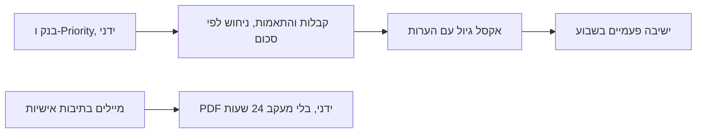

**עם הסוכנים:**

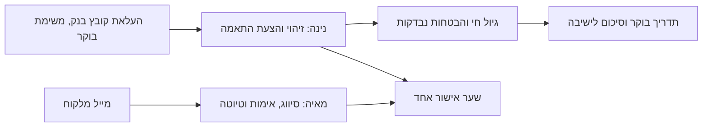

## Customer & scope

**סימנט** מייצרת ומפיצה חומרי בניין בישראל. ה-ERP שלה הוא Priority, מותקן מקומית (on-prem), והגישה אליו עוברת כנראה דרך IT של מספנות ישראל. **מחלקת הגבייה** כוללת את יניב (מנהל גבייה) ו-2–3 מנהלות חשבונות (קרן, בת שבע, אביב). ביטוח האשראי הוא בבסס״ח (לאימות). הבנקים הם מזרחי, שהוא הבנק הראשי, ובינלאומי. המייל הוא Outlook / Microsoft 365, בתיבות אישיות.

**בסבב הזה:** ארבעת הבלוקים: תקבולים והתאמות, מענה ושירות (כרטסת, חובות פתוחים, תעודות חסרות, הפרשי מחיר), גיול והבטחות, וביטוח אשראי. **סדר העדיפות:** גיול והבטחות, תקבולים, מיילים 2א/2ב, 2ג/2ד, ביטוח.

**מחוץ לסבב, לפי הבריף:** הפקדות צ׳קים, התאמות בנקים, פתיחת לקוחות (כולל בקשת ביטוח ללקוח חדש), כרטיסי אשראי, הזמנות חסומות לעומק (נקודת המגע עם מוקד ההזמנות), שירותים נוספים של בסס״ח, הערות על גבי תעודות, סולם הסלמה יזום מול לקוחות, שיחות קוליות, לינק תשלום, שליחה בפועל של מיילים, סיכום שבועי "נשלח ולא נענה", וכתיבה ל-Priority. המסכים הקיימים של הזמנות חסומות וכללי הסלמה **נשארים כמו שהם ולא מורחבים**, והזמנות חסומות **מוסתרות מהתפריט**.

**לא בונים מה שלא נסגר עם יניב.** מה שלא נדון איתו לא נכנס לסכמה ולא למסכים, גם אם הוא נראה מתבקש.

## Understanding

**You said:** לבנות עכשיו את ארבעת הדברים מהסשן עם יניב (20.10), להציג אותם ביום ראשון 25.10, לקבל פידבק, ורק אז להוסיף עוד. העבודה היא באיטרציות של 1–3 ימים, וכל איטרציה צריכה משהו שאפשר לבדוק על המסך. לכל בלוק תהיה דיאגרמה של טריגר → עבודה → תוצר. העקרונות שלא משתנים:
- בלי mock data. רק נתוני בדיקה מסומנים, שנמחקים בפעולה אחת.
- Priority בקריאה בלבד.
- שום דבר לא נשלח החוצה. רק טיוטות, עם סימון גלוי "לא נשלח".
- כללים קבועים נכתבים בקוד ולא בהוראות לסוכן.
- כל שורה שסוכן קורא מכילה שמות לתצוגה.
- פרקטי לפני יפה.

ההחלטות מהסבבים:
- סדר הבנייה והעדיפות: גיול והבטחות → תקבולים → מיילים 2א/2ב → 2ג/2ד → ביטוח.
- לו״ז: היום (21.10) איטרציה גדולה אחת ואחת לתיקונים. מחר (22.10) יום מלא, שבת (24.10) יום מלא, ראשון בבוקר אולי. המטרה עד שבת: בסיס עובד לשיחה עם יניב, שמראה איך זה ייראה כשהכל מחובר. לא חייב שהכול יהיה גמור. מה שלא יושלם עד הסוף יוצג כזרימה על נתוני הבדיקה.
- מותר להעלות קבצים שמייצאים מ-Priority כגשר זמני.
- כ-10 לקוחות בדיקה, כל אחד תרחיש מהשיחה.
- שתי סוכנות: נינה ומאיה.
- Outlook. מאיה קוראת את **כל** המיילים בתיבות העבודה.
- תיבת הבדיקה עד אז: ה-Gmail של סער (saar@blocks.diy), ורק מיילים עם הלייבל "Ciment-Test". חיבור התיבה הוא שכבה נפרדת שמחליפים ב-Outlook בלי לשנות לוגיקה.
- מייל שסווג "לא רלוונטי" נשמר בלי הגוף שלו.
- אין שעה קבועה בבוקר. במסך "היום" יש משימת חובה להעלות את קובץ הבנק של אתמול ואת קובץ החשבוניות הפתוחות (עד שיהיה API). ההעלאה מפעילה את ההתאמות ואת התדריך.
- הבטחה: "נראה תשלום" כשיש התאמה מאושרת לשורת בנק, ו"נקיימה" רק אחרי "בוצע ב-Priority".
- אישורי מחיר: הסוכנים והמנהלים לא נכנסים לאפליקציה. האחראית מסמנת "סוכן אישר" ו"מנהל אישר", עם ראיה חובה.
- שמות הסוכנות: מהקטלוג המובנה של Blocks (Nina, Maya), ושמורים לאפליקציה הזו.
- פנייה ללוגיסטיקה במייל פנימי.
- חלון הגיול: 3 חודשים אחורה והחודש הנוכחי.
- לקוח בלי פירוט: אחרי 3 ימי עסקים עובר לסיכום של יניב לישיבה.

**I assumed:**
- החיבור לתיבה (Gmail לבדיקה, Outlook בהמשך) נעשה פעם אחת לכל תיבה ונשמר בשרת. ההאזנה רצה 24/7 גם כשאף אחד לא מחובר לאפליקציה.
- ה-PDF של הכרטסת ושל החובות הפתוחים מופק אצלנו מהנתונים שהגיעו מ-Priority, עם חותמת "תצוגה – נכון ל…". הוא מותר לדמו וזמני עד שתחליטו (ראו Open questions).
- "שלי" נקבע לפי התאמה בין כתובת המייל של המשתמשת המחוברת לרשימת הצוות. לקוח שאין לו אחראית מופיע אצל כולן. לא צריך תפקידים נפרדים באפליקציה, כי כולן רואות הכול וההבדל הוא רק בסינון.
- שתי השאלות שהשארת פתוחות (מי מאשר את המנה של ה-15, והאם לרדוף אחרי הלוגיסטיקה אוטומטית) נבנות כהגדרות שיניב מחליט עליהן.

**Success:** בשיחה עם יניב (בסיס עובד עד שבת) הוא עובר על יום עבודה שלם על נתוני הבדיקה. בלוק שלא הושלם מוצג כזרימה על אותם נתונים:
1. משימת הבוקר "להעלות את קובץ הבנק של אתמול", ואחרי ההעלאה התדריך של נינה.
2. ההעברה של 17,424 מותאמת לבד ל-3 חשבוניות, ו"אבי ובניו" מזוהה כגולף אחרי אישור כינוי.
3. ההבטחה מה-10 עוברת ל"נראה תשלום" כשההתאמה ב-11 מאושרת, ול"נקיימה" אחרי סימון "בוצע ב-Priority".
4. מייל של "חסרות לי תעודות" הופך לבקשה ללוגיסטיקה, ואחרי הסריקה לחבילה מלאה ללקוח.
5. הפרש מחיר: האחראית מסמנת "סוכן אישר" ואז "מנהל אישר", כל אחד עם ראיה, והמקרה מגיע ל"ממתינה לזיכוי".
6. בקשת כרטסת משולח לא מוכר מקבלת משימה "לאמת בטלפון".
7. לקוח ב-80% מקבל הצעת הגדלה של 50%.

ובנוסף: אם יניב ישלח עד אז את אקסל הגיול, הוא נטען לאפליקציה עם ההערות האמיתיות.

## Decisions

- **אפליקציה אחת שמסודרת לפי סדר היום של יניב,** ולא ארבעה מודולים נפרדים. **נדחה:** מסך נפרד לכל בלוק בלי בית משותף, כי יניב תיאר יום אחד (בוקר → מיילים → גיול) ולא ארבע מערכות.
- **שתי סוכנות.**
  - **נינה** עובדת ברצף שמתחיל בהעלאת קבצי הבוקר: תקבולים, הבטחות, גיול וביטוח.
  - **מאיה** מופעלת מכל מייל נכנס: מסווגת, מאמתת ומנסחת.
  - **מה מפריד ביניהן:** טריגר (העלאת קובץ מול מייל) ואופי עבודה (חישוב ומנות מול ניסוח בשם האחראית).
  - **נדחה:** סוכנת אחת, כי ההוראות היו מערבבות שני אופני עבודה. גם ארבע סוכנות נדחו, כי התאמות וגיול הם אותו רצף.
- **שמות הסוכנות מהקטלוג המובנה של Blocks:** נינה היא הפרסונה **Nina** (כבר על CollectionsAgent, עם התמונה של Nina), ומאיה היא הפרסונה **Maya**. בשדה `title` נכתב השם בדיוק כמו בקטלוג ("Nina", "Maya"), כי האיות הזה מחבר את התמונה, הקול והסרטון של הפרסונה. בממשק העברי הן מוצגות כ"נינה" ו"מאיה". השם הפונקציונלי של הסוכנת החדשה הוא **CollectionsInboxAgent** (ולא InboxAgent), כדי שלא יתנגש עם סוכנת דואר של מוקד ההזמנות. **שמור לאפליקציה הזו:** Nina, Maya, CollectionsAgent, CollectionsInboxAgent. מוקד ההזמנות בוחר מהשאר בקטלוג (Morgan, Leo, Ron, Olive, Eva, Nora, Stella ועוד).
- **המנועים הם code actions דטרמיניסטיים, והסוכנות רק קוראות להם.** זה חל על התאמה, גיול, בדיקת הבטחות, ניצול ביטוח וזכאות לחובות פתוחים. **נדחה:** חישוב בתוך הפרומפט, כי הוא לא ניתן לבדיקה ולא חוזר על עצמו.
- **הגיול מחושב ב-code action ולא ב-view** (BuildAgingReport, עם פרמטרים של חלון ותאריך). view לא מקבל פרמטרים, וחלון שמשתנה (חוב קודם, חודשים, חוב מאוחר) צריך חישוב. אותו מנוע משרת את המסך, את נינה ואת הסיכום לישיבה. ה-views משמשים רק למספרים בכותרות, וכך נפתר גם החסם של הסכומים שסופרים רק שורות שנטענו.
- **ההאזנה למיילים עוברת דרך חיבור תיבה וזרימה (workflow) שמפעילה את מאיה.** **נדחה:** ערוץ המייל המובנה של סוכן, כי כלי המענה שלו עונה ישירות בשרשור ואי אפשר לעכב אותו לאישור. זה סותר את העיקרון "שום דבר לא נשלח".
- **חיבור התיבה הוא שכבה שמחליפים.** הזרימה של כל תיבה רק ממירה את המייל לצורה אחידה (messageId, threadId, mailbox, from, subject, body, receivedAt, attachments, mailProvider) וקוראת ל-IngestEmail. כל הלוגיקה (כפילויות, זיהוי, אימות, סיווג, דדליין) נמצאת אחרי הנקודה הזו ולא יודעת מאיזה ספק הגיע המייל. **עכשיו:** זרימה אחת לתיבת הבדיקה Gmail של סער (saar@blocks.diy), שקוראת רק מיילים עם הלייבל "Ciment-Test". **אחר כך:** זרימה לכל תיבת Outlook, שקוראת לאותה פעולה. **גיבוי ל-Outlook:** הרשאת אפליקציה ב-Microsoft 365 מ-IT של סימנט (Graph, מוגבלת לתיבות הגבייה). **גיבוי ל-Gmail:** אם הטריגר לא מסנן לפי לייבל, בדיקה כל 5 דקות של `label:Ciment-Test`. שניהם נבדקים בתחילת איטרציה 6.
- **מייל שסווג "לא רלוונטי" נשמר בלי הגוף שלו:** נשארים מזהה, שולח, נושא, תאריך והסיווג (כדי שלא יעובד שוב ושאפשר יהיה לבדוק את הסיווג), והגוף והקבצים נמחקים באותה פעולה.
- **שער אישור אחד:** הטבלה הקיימת Approvals מורחבת. אישור מעביר את הטיוטה ל"אושר – לא נשלח", וזה הסוף של המסלול בסבב הזה. **לא בונים פעולת שליחה ולא מתג שליחה.** כשתוחלט שליחה, היא תתווסף כפעולה חדשה על אותם סטטוסים (הערך "נשלח" כבר קיים), בלי שינוי סכמה. **נדחה:** כפתור שליחה פעיל, וגם פעולת שליחה כבויה, כי זה לא סוכם.
- **כל פעולה ב-Priority מופיעה כהצעה עם שני מצבים:** "אושר – לביצוע ב-Priority" ואחר כך "בוצע ב-Priority". אדם מסמן את השני. כשתהיה כתיבה ל-Priority, הפעולה תבצע אוטומטית רק הצעות בוודאות "ודאי", בלי לשנות את הסכמה.
- **שימוש חוזר ולא טבלאות כפולות:**
  - Disputes משמשת למקרים של תעודות חסרות ושל הפרשי מחיר.
  - CollectionQueue היא רשימת המשימות של האחראית.
  - CreditLimitRequests משמשת לבקשות ביטוח.
  - PaymentPromises משמשת להבטחות.
  - Interactions היא ציר הזמן של תמונת 360.
  - **נדחה:** טבלה נפרדת לכל בלוק, כי היא מפצלת את תמונת הלקוח.
- **הקישורים בין טבלאות נשארים בטקסט** (customerCode, invoiceNumber, ומזהה רשומה כטקסט). **נדחה:** עמודות reference, כי טבלה חדשה קיימת רק אחרי sync, ו-reference לטבלה מאותו sync נכשל בשקט.
- **העלאת קבצים כגשר זמני:** האקסל של הגיול (כולל ההערות), קובץ הבנק, חשבוניות פתוחות, כרטיסי לקוח. השורות מסומנות במקור `priority-file`, וה-API יחליף אותן לפי אותם מפתחות ייחודיים. **סיכון:** את מיפוי העמודות אפשר לסגור רק כשהקובץ מגיע.
- **הבוקר מתחיל בהעלאה, לא בשעה.** אין ריצה קבועה ב-08:30. במסך "היום" מופיעות כל בוקר שתי משימות חובה: "להעלות את קובץ הבנק של אתמול" (יום העסקים הקודם, כך שביום א׳ זה קובץ של יום ה׳) ו"להעלות את קובץ החשבוניות הפתוחות" (עד שיהיה API). כל משימה נשארת עד שיש ייבוא מוצלח מאותו סוג עם תאריך הנתונים הנכון. ההעלאה מפעילה את ההתאמות, את בדיקת ההבטחות ואת התדריך. **נדחה:** ריצה בשעה קבועה, כי בלי קובץ אין על מה לרוץ.
- **זיהוי לקוח, שלב "היסטוריה":** נבנה משורות בנק קודמות שכבר שויכו ללקוח (BankLines עם customerCode, ו-MatchProposals שאושרו או בוצעו), לפי שם המעביר. **נדחה:** היסטוריה מ-Payments, כי אין שם שם מעביר. בנתוני הבדיקה יש שורות בנק משויכות מהחודש הקודם, כדי שהשלב הזה יעבוד בדמו.
- **סטטוס הבטחה משקף את הסדר האמיתי:** קודם רואים העברה בבנק, ורק אחר כך נבנית קבלה ב-Priority. לכן: "פתוחה" → "נראה תשלום" (יש התאמה מאושרת לשורת בנק) → "נקיימה" או "נקיימה חלקית" (רק אחרי "בוצע ב-Priority", או כשהקבלה מופיעה במראה של Payments). "הופרה" כשעבר יום הבדיקה ואין לא התאמה מאושרת ולא קבלה.
- **אישורי מחיר בלי לוגין לסוכנים:** הסוכן והמנהל שלו לא משתמשים באפליקציה. האחראית מסמנת "סוכן אישר" ואחר כך "מנהל אישר". בכל סימון חובה לצרף ראיה (טקסט המייל שלהם או קישור), והאפליקציה שומרת מי סימן ומתי. הכלל נאכף בפעולה ולא בממשק: בלי ראיה אין סימון, ואין "מנהל אישר" לפני "סוכן אישר". **נדחה:** תפקיד או לוגין לסוכנים.
- **סט תרחישים לבדיקה:** כ-10 לקוחות בדיקה (TEST-001 עד TEST-010), כל אחד תרחיש מהשיחה. הכול מסומן `test-fixture` ונמחק בפעולה אחת. הסט מחליף את שני הלקוחות הקיימים.
- **"שלי" מול "של כולם":** מתג גלובלי בסרגל העליון. האחראית נקבעת כך: קודם הגדרה ידנית באפליקציה (טבלת CustomerOwners), ואם אין, השדה מ-Priority. לקוח בלי אחראית מופיע אצל כולן. זה עובד גם כשהחלוקה קיימת וגם כששתיים מטפלות בכל הלקוחות.
- **ביטוח, רק מה שנדון:** ניצול 80%, הצעת הגדלה של 50%, אישור אדם, ומעקב סטטוס ידני. **הוצא לגמרי:** "לקוח חדש" (הכפתור, הטופס, השדות requestType ו-triggerReason, והטריגר של לחיצה), כי פתיחת לקוחות עוד לא נדונה. **insurerFields** נשאר JSON כללי עד שיגיעו השדות המדויקים ממדריך ה-API של ICIC (בסס״ח).
- **הערות גיול לכל חודש, גם עתידי:** monthKey מקבל כל חודש בפורמט YYYY-MM (עבר, נוכחי או עתידי), וגם "חוב קודם" ו"חוב מאוחר". יניב כותב הערות עד דצמבר, אז הערה לחודש שאחרי החלון מוצגת בעמודת "חוב מאוחר" עם שם החודש שלה. בורר החלון יכול להרחיב קדימה עד החודש האחרון שיש בו הערה או חוב.
- **הגדרות שהן הנחה מסומנות ככאלה:** לכל הגדרה יש שדה "מקור" (החלטת יניב, הנחה, ברירת מחדל). remittanceEscalationDays=3 מסומנת "הנחה", וכך גם כל ערך שעוד לא אושר. במסך ההגדרות הנחה מקבלת תגית "הנחה – לאשר עם יניב".
- **PDF של כרטסת וחובות פתוחים מותר לדמו,** עם חותמת "תצוגה – נכון ל…" בכל עמוד. זה זמני עד שתחליטו אם מסמך שאנחנו מפיקים מקובל ללקוח.
- **איטרציה 4 מתפצלת לשלושה סבבים, כי טבלה חדשה קיימת רק אחרי sync:** 4a הסכמה כולה ב-sync אחד, ואחריו קריאה חוזרת של הסכמה החיה. 4b נתוני הבדיקה ומנוע הגיול: קודם dry-run, אחר כך כתיבה אמיתית עם writeVerified. 4c המסכים. **נדחה:** סכמה, נתונים ומסכים באותו סבב, כי פעולה שכותבת לטבלה שעוד לא קיימת נכשלת.

## Data

**בשורה אחת:** 9 טבלאות חדשות שלנו ו-5 מראות חדשות של Priority. 9 טבלאות קיימות מתרחבות, ו-4 קיימות לא משתנות. הפירוט המלא, עמודה עמודה, נמצא בסעיף "Iteration 4a" בסוף התוכנית.

**טבלאות קיימות שמתרחבות** (רק העמודות או הסטטוסים החדשים):

| Table | Fields |
|--|--|
| Customers (מראה) | + companyId (ח״פ), + primaryEmail, + priceListCode, + ledgerBalance (יתרת כרטיס), + insurerCaseNumber. המסגרת המבוטחת היא העמודה הקיימת insuranceApprovedAmount. source מקבל גם `priority-file` |
| Invoices (מראה) | + documentType (חשבונית, חשבונית זיכוי), + sourceDocUrl (מקור החשבונית מהנספחים), + productLine; source מקבל גם `priority-file` |
| DeliveryNotes (מראה) | + productLine, + scanUrl, + scannedAt |
| Payments (מראה של קבלות) | + receiptNumber, + bankLineId; source מקבל גם `priority-file` |
| PaymentPromises | + promiseSource (שיחה, דואל, ישיבה, ייבוא), + assignedBookkeeperName, + checkOn (יום עסקים אחרי תאריך ההבטחה), + seenAt, + seenBankLineId, + matchProposalId, + matchedReceiptRefs, + matchedAmount, + keptAt, + inboundEmailId. סטטוסים: פתוחה, **נראה תשלום**, נקיימה, נקיימה חלקית, הופרה |
| Disputes | סוגים: משתמשים בקיימים, "תעודת משלוח חסרה" (2ג) ו"מחיר" (2ד). + inboundEmailId, + missingNoteNumbers, + productLine, + logisticsOwnerName, + logisticsOwnerEmail, + nextReminderAt, + reminderCount, + salesAgentName, + salesManagerName, + salesAgentApprovedAt, + salesAgentApprovalMarkedBy, + salesAgentApprovalEvidence, + salesManagerApprovedAt, + salesManagerApprovalMarkedBy, + salesManagerApprovalEvidence, + creditDraftNote. סטטוסים: פתוחה, בטיפול, ממתינה לסריקה, תזכורת בטיוטה, הוסלמה, ממתינה לאישור סוכן, ממתינה לאישור מנהל, ממתינה לזיכוי, מוכנה לשליחה ללקוח, נסגרה |
| Approvals (השער) | סוגים: + מענה ללקוח, + בקשת פירוט, + מנת חובות פתוחים, + פנייה ללוגיסטיקה, + בקשת אישור מחיר, + הצעת קבלה. בקשת ביטוח משתמשת בקיים "בקשת הגדלת מסגרת". + relatedTable, + relatedId, + fromMailbox, + attachmentUrls, + batchId. סטטוסים: ממתין, אושר – לא נשלח, אושר – לביצוע ב-Priority, בוצע, נשלח (קיים, לא בשימוש בסבב הזה), נדחה |
| CreditLimitRequests (הגדלות בלבד) | + triggeredAtPct, + companyId, + currency, + insuredLimitAtRequest, + insurerFields (JSON כללי, עד מדריך ICIC), + decidedBy, + decidedAt, + submittedAt, + approvedAmount, + insurerCaseNumber, + insurerResponseNote. סטטוסים: הוצעה ע״י הסוכנת, ממתינה להגשה, הוגשה למבטח, אושרה, אושרה חלקית, נדחתה, עודכן ב-Priority (וגם טיוטה, הקיים) |
| CollectionQueue (רשימת המשימות) | + taskType (צ׳ק חוזר, לא מזוהה, התאמה לבדיקה, הבטחה הופרה, לאמת שולח, פירוט לא התקבל, ביטוח 80%, אחר), + relatedTable, + relatedId, + dueAt |

**טבלאות קיימות שלא משתנות:** Interactions (ציר הזמן לכל לקוח), TeamMembers, BlockedOrders, EscalationRules. שתי האחרונות קפואות, כי הנושאים שלהן מחוץ לסבב.

**מראות חדשות של Priority** (קריאה בלבד. כל אחת עם source ו-syncedAt):

| Table | Fields |
|--|--|
| CustomerContacts | contactKey (ייחודי), customerCode, customerName, contactName, email, phone, roleFlags (הנהלת חשבונות, רכש, ראשי, אחר) |
| BankLines | bankLineId (ייחודי), valueDate, amount, payerName, reference, bankAccount, lineType (העברה, צ׳ק, צ׳ק חוזר, אחר), customerCode, customerName (נכתבים כשהתאמה אושרה, ומשמשים כ"היסטוריה" לזיהוי), importBatchId, status (חדשה, יש הצעה, לבדיקה, לא מזוהה, אושרה – לביצוע ב-Priority, בוצעה ב-Priority) |
| LedgerEntries (כרטסת) | entryKey (ייחודי), customerCode, customerName, entryDate, valueDate, docType, docNumber, details, debit, credit, runningBalance |
| InvoiceLines | lineKey (ייחודי), invoiceNumber, orderNumber, customerCode, sku, itemName, quantity, unitPrice, lineTotal, priceSource (הזמנה, מחירון, ידני), managerApprovalStatus, freeText |
| PriceListItems | priceKey (ייחודי), priceListCode, customerCode, siteName, sku, price, validFrom, validTo |

**טבלאות חדשות שלנו:**

| Table | Fields |
|--|--|
| BankAliases | bankName, customerCode, customerName, status (מוצע, מאושר, נדחה), proposedFromBankLineId, approvedBy, approvedAt |
| MatchProposals | bankLineId, valueDate, amount, payerName, customerCode, customerName, customerIdMethod (שם זהה, איש קשר, היסטוריה, כינוי, ידני), invoiceNumbers, allocations (JSON: חשבונית, סכום), matchMethod (מספרי חשבוניות מפירוט, סכום = פירעון זהה, סכום ייחודי, ידני), confidence (ודאי, גבוה, נמוך), reasoning, assignedBookkeeperName, status (מוצעת, אושרה – לביצוע ב-Priority, בוצעה ב-Priority, נדחתה, הוחלפה), decidedBy, decidedAt |
| InboundEmails | messageId (ייחודי), threadId, mailProvider (gmail, outlook), mailbox, mailboxOwnerName, sourceLabel, fromAddress, fromName, subject, bodyText (ריק כשהסיווג "לא רלוונטי"), bodyStored, receivedAt, dueAt (+24 שעות), customerCode, customerName, senderVerification (מאומת, לא מאומת, לבדיקה), category (כרטסת, חובות פתוחים, תעודות וחשבוניות חסרות, הפרש מחיר, פירוט תשלום, הבטחת תשלום, אחר, לא רלוונטי), mentionedInvoiceNumbers, attachmentNames, status (חדשה, בטיפול מאיה, טיוטה מוכנה, ממתינה לגורם פנימי, נענתה, לא רלוונטית), assignedBookkeeperName, agentSummary, answeredAt |
| AgingNotes | customerCode, customerName, monthKey (כל חודש YYYY-MM, כולל עתידי, או "חוב קודם" או "חוב מאוחר"), noteText, authorName, writtenAt, noteSource (אפליקציה, ייבוא אקסל, ישיבה) |
| ProductLineContacts | productLine, logisticsOwnerName, email, phone, active |
| CustomerOwners | customerCode, customerName, bookkeeperName, setBy, setAt |
| AgentSettings | settingKey (ייחודי), value, label, description, basis (החלטת יניב, הנחה, ברירת מחדל). ערכי פתיחה: openDebtsDay=15, openDebtsApprover=מנהל גבייה (הנחה), logisticsAutoChase=false (ברירת מחדל), logisticsReminderHours=24, remittanceEscalationDays=3 (**הנחה**), agingMonthsBack=3, insuranceThresholdPct=80, insuranceIncreasePct=50, replySlaHours=24, testMailboxLabel=Ciment-Test |
| AgentBriefings | briefingDate, agentName, audience (שם אחראית או כולם), headline, body, counts (JSON), triggeredByImportId, briefingCreatedAt |
| ImportBatches | fileName, fileUrl, kind (דוח גיול, קובץ בנק, חשבוניות פתוחות, כרטיסי לקוח, אנשי קשר), dataDate (תאריך הנתונים בקובץ), uploadedBy, uploadedAt, rowsRead, rowsWritten, status (נקרא, נכתב, נכשל), errors |

**Views** (מספרי כותרות מדויקים, מחושבים בשרת):

| View | Shows |
|--|--|
| DebtTotals | סך כל היתרה הפתוחה, סך מה שבפיגור (פירעון עד היום), ומספר הלקוחות בחוב. בסינון לפי אחראית |
| CustomerBalances | לשורה לכל לקוח: יתרה פתוחה, בפיגור, תשלום אחרון, הבטחות פתוחות ואחוז ניצול ביטוח |
| ReceiptsToday | ספירת הצעות התאמה לפי סטטוס וּודאות, וספירת שורות לא מזוהות |
| InboxSla | פניות פתוחות לפי סטטוס ולפי אחראית, וכמה מהן חרגו או יחרגו מ-24 שעות בשעתיים הקרובות |
| PromisesDue | הבטחות לפי תאריך בדיקה וסטטוס (משמש ליומן ולתדריך) |
| ~~InsuranceWatch~~ | **נמחק ב-27.10.** במקומו GetCreditExposure (ראו DESIGN_03_CREDIT.md) |
| CreditCovers / CustomerExposure / ExposureItems (מראות, 27.10) | מכסת הביטוח, האובליגו הסטטי ב-Priority, ופירוט האובליגו לפי סוג. השדות creditInsurer, insurerCaseNumber, insuranceApprovedAmount, obligoUsed ו-obligoPct עברו מ-Customers לכאן |

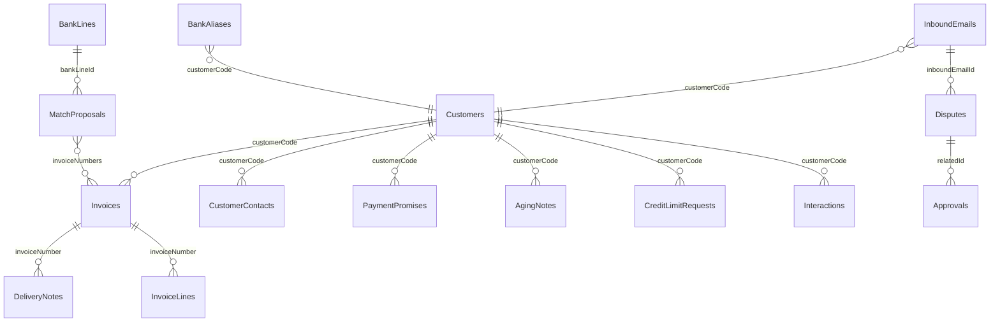

**מה חי ב-Priority ומה חי אצלנו:** כל המראות נקראים מ-Priority (בשלב הזה מקבצים, ובהמשך מה-API) ולעולם לא נכתבים מהממשק. כל השאר הוא שלנו: הערות, הבטחות, כינויים, הצעות, פניות, מקרים ואישורים. **החוק של הגיול:** רק חשבונית יוצרת חוב, לפי תאריך פירעון, ותעודה שלא הפכה לחשבונית לא נחשבת. **החוק של ההתאמה:** הסדר הוא מספרי חשבוניות, אחר כך סכום ששווה לחשבוניות עם אותו פירעון, אחר כך סכום ייחודי, ובסוף אדם. אף פעם לא סוגרים לפי סכום כשיש באותו חודש כמה חשבוניות באותו סכום.

## Pages & UI

**בשורה אחת:** המיני-אפליקציה של הצוות (בכתובת `/`) מסודרת לפי סדר היום. לנינה ולמאיה יש מיני-אפליקציות שיחה משלהן. תמונת 360 נמצאת בכרטיס הלקוח, ונפתחת מכל שם לקוח בכל מסך.

**מיני-אפליקציות** (לפי הסדר):
1. `/` **גבייה**, מיני-אפליקציית עמודים לכל הצוות (קיימת).
2. `/nina` **נינה**, מיני-אפליקציה של סוכנת. נפתחת על שיחה חדשה. יש לה עמוד אחד: "תדריכי בוקר", ההיסטוריה של התדריכים שלה.
3. `/maya` **מאיה**, מיני-אפליקציה של סוכנת. נפתחת על שיחה חדשה, בלי עמודים נוספים. תור הפניות שייך לצוות ולכן נמצא ב-`/`.

**עמודים במיני-אפליקציה של הצוות, לפי סדר היום** (חדש / משתנה / קיים):

| Route | עמוד | למי | מה רואים ועושים | |
|--|--|--|--|--|
| `/` | **היום** (היה "תור היום") | כל אחראית, ויניב ב"של כולם" | בראש המסך **משימות החובה של הבוקר**: "להעלות את קובץ הבנק של אתמול" ו"להעלות את קובץ החשבוניות הפתוחות", כל אחת עם כפתור העלאה, והן נשארות עד שמעלים. אחרי ההעלאה: התדריך של נינה, מה עשתה ומה מחכה לך. מתחת: צ׳קים חוזרים, התאמות לבדיקה, הבטחות מאתמול (בוצעו / לא), פניות קרובות לחריגה, ביטוח 80%, ורשימת המשימות | משתנה |
| `/receipts` | **תקבולים** | אחראיות | לשוניות: ודאי (אישור במנה), לבדיקה, לא מזוהה, בוצע. בכל שורה: הוכחת ההתאמה ושרשרת זיהוי הלקוח. אישור, תיקון, דחייה, ואחר כך "בוצע ב-Priority". תת-לשונית של כינויים | חדש |
| `/inbox` | **פניות** | אחראיות ויניב | תור עם טיימר 24 שעות, סוג, תיבה ואימות שולח. במגירה: המייל המקורי, הניתוח של מאיה והטיוטה עם ה-PDF. "אשר", ואז הטיוטה עוברת לסטטוס "אושר – לא נשלח" | חדש |
| `/inbox/open-debts` | **חובות פתוחים, 15 לחודש** | מי שמוגדר כמאשר | מנה: לקוחות זכאים, לקוחות שהוחרגו ולמה (יתרת זכות, תקבולים פתוחים), תצוגה מקדימה של כל PDF, ואישור המנה | חדש |
| `/aging` | **דוח גיול** | כולם | בורר חלון. טבלה לפי לקוח: חוב קודם, חודשי החלון, חוב מאוחר, סה״כ. הערה לכל חודש, עם היסטוריה. הבטחות על התאים. מצב **ישיבה** ליניב: לכל אחראית ההבטחות שהגיעו, אלה שהופרו ומה השתנה מאז הישיבה הקודמת | חדש |
| `/promises` | **הבטחות**, כמו "פגישות בלוח השנה" | אחראיות | תצוגת יומן ושבוע. כל הבטחה עם סטטוס (פתוחה, נראה תשלום, נקיימה, נקיימה חלקית, הופרה), עם שורת הבנק שנראתה ועם הקבלה שקושרה אליה | משתנה |
| `/disputes` | **מסמכים ומחירים** (היה "מחלוקות") | אחראיות | שני מסלולים. תעודות חסרות: בקשה, תזכורת, סריקה, חבילה מוכנה. הפרש מחיר: ניתוח פער, ואז שני סימונים של האחראית, "סוכן אישר" ו"מנהל אישר". כל סימון פותח חלון שבו חובה להדביק את טקסט המייל או קישור, ונשמרים מי סימן ומתי. אחרי שניהם: ממתינה לזיכוי | משתנה |
| ~~`/insurance`~~ | ~~ביטוח אשראי~~ | | **הוסר ב-27.10.** הביטוח עבר ללשונית בכרטיס הלקוח, וההתראות למסך היום | הוסר |
| `/customers/[code]` | **כרטיס לקוח 360** | כולם | כותרת עם יתרה, מסגרת אשראי, ביטוח, אחראית וסוכן. ציר זמן אחד: חשבוניות, קבלות, הבטחות, הערות, פניות, מקרים וביטוח. לשוניות לכל אחד מהם, ומ-27.10 גם **"אובליגו וביטוח"** (רק ללקוח מבוטח, `?tab=credit`): מכסה, אובליגו סטטי ודינמי, ניצול, פירוט לפי סוג, וכפתורי דמה ל-ICIC | משתנה |
| `/approvals` | **אישורים** (השער) | כולם | כל מה שממתין. אחרי אישור, הפריט מקבל את הסימון הגלוי "אושר – לא נשלח". אין כפתור שליחה | משתנה |
| `/settings` | **הגדרות** | יניב | הגדרות הסוכנות, כל אחת עם מקור (החלטת יניב, הנחה, ברירת מחדל) ותגית "הנחה – לאשר עם יניב" כשצריך. אנשי קשר של הלוגיסטיקה לפי קו מוצר, אחראית לכל לקוח, כינויים, צוות, וחיבור התיבות (כרגע תיבת הבדיקה Gmail עם הלייבל) | משתנה |
| `/settings/imports` | **ייבוא מ-Priority** | יניב, נווית | העלאת קובץ ובחירת סוג, תצוגת "מה ייכתב" לפני הכתיבה, ואחר כך כתיבה והיסטוריית ייבוא | חדש |
| `/customers`, `/invoices`, `/blocked-orders` | קיימים | | `/blocked-orders` קפוא (מחוץ לסבב) ומוסתר מהתפריט. העמוד נשאר בכתובת שלו | קיים |

**התפריט** (מימין), לפי סדר היום: היום · תקבולים · פניות · דוח גיול · הבטחות · מסמכים ומחירים · ביטוח · לקוחות · חשבוניות · אישורים. ההגדרות בתחתית. הזמנות חסומות לא בתפריט. בסרגל העליון: **מתג שלי / של כולם**, חיפוש לקוח, ו"שאל את נינה" (צ׳אט צד).

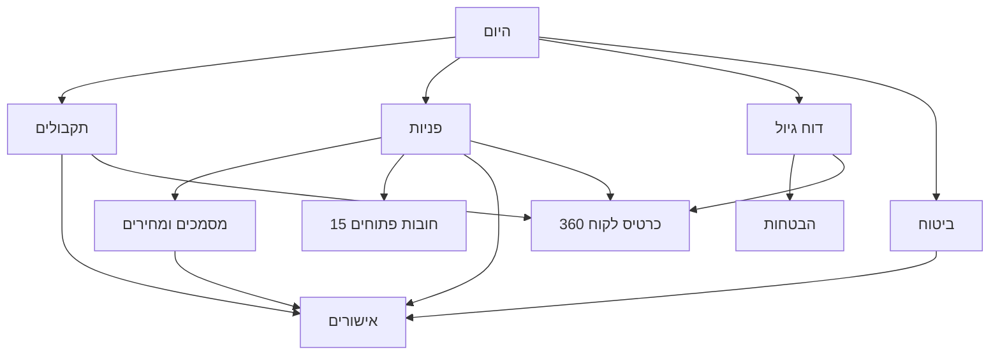

**הוויזואל המרכזי של כל מסך:**
- **תקבולים:** "הוכחת ההתאמה", משוואה מצ׳יפים: `17,424 = 5,808 + 5,808 + 5,808 · פירעון 30.9`.
- **פניות:** טבעת ספירה לאחור של 24 שעות.
- **דוח גיול:** הטבלה עם סמני הבטחה על החודש.
- **ביטוח:** פס ניצול מול קו 80% (מהרכיב הקיים ObligoBar).
- **מסמכים:** מונה סריקות, למשל 4/6.
- **היום:** משימות ההעלאה כשתי כרטיסיות בולטות בראש המסך, עם תאריך הקובץ החסר.
- **PDF של כרטסת וחובות פתוחים:** חותמת "תצוגה – נכון ל…" בכל עמוד.

**סטטוסים:** לפי Liquid+. שגרתי = זכוכית לבנה, ממתין לאישור = ענבר, דחוף או חריגה = קריטי, בוצע = הצלחה. הכחול רק לכפתור הראשי של כל מסך.

**שפה:** עברית, RTL. בכל מסך: הסוכנת והאווטאר שלה למעלה, עם מה שעשתה ומה היא ממליצה, והנתונים מתחת כראיה. כשאין נתונים, המסך אומר למה הסוכנת מחכה.

## Agents & workflows

### נינה (CollectionsAgent, קיימת, פרסונה Nina): רצף הבוקר

- **אופי עבודה:** תפעולי, במנות.
- **מה מפריד אותה ממאיה:** מופעלת מהעלאת קבצי הבוקר, לא ממייל, ולא מנסחת מול לקוחות.
- **"עבודה טובה":** "יעשה את התקבולים לבד, יעשה את ההתאמות לבד". "קודם כל תורידי ממני מה שמתאים". "יגיד לי במרוכז מי הלקוחות שאמרו לי ב-6, מי ב-10… למחרת".
- **כלים** (כולם code actions, ולא ריקים):
  - RunMatching
  - DecideMatchProposal
  - CheckPromises
  - BuildAgingReport
  - ProposeInsuranceRequests
  - GetCustomer360
  - RecordPromise
  - AddAgingNote
  - CreateTask
  - WriteBriefing
- **גבולות:** לא כותבת ל-Priority ולא פונה ללקוחות. כינוי חדש תמיד מחכה לאישור אדם. התאמה בוודאות שאינה "ודאי" לא מאושרת במנה.
- **צ׳אטים:**
  - הצ׳אט במיני-אפליקציה `/nina`.
  - "שאל את נינה" בסרגל העליון של `/`.

#### בלוק 1: תקבולים והתאמות

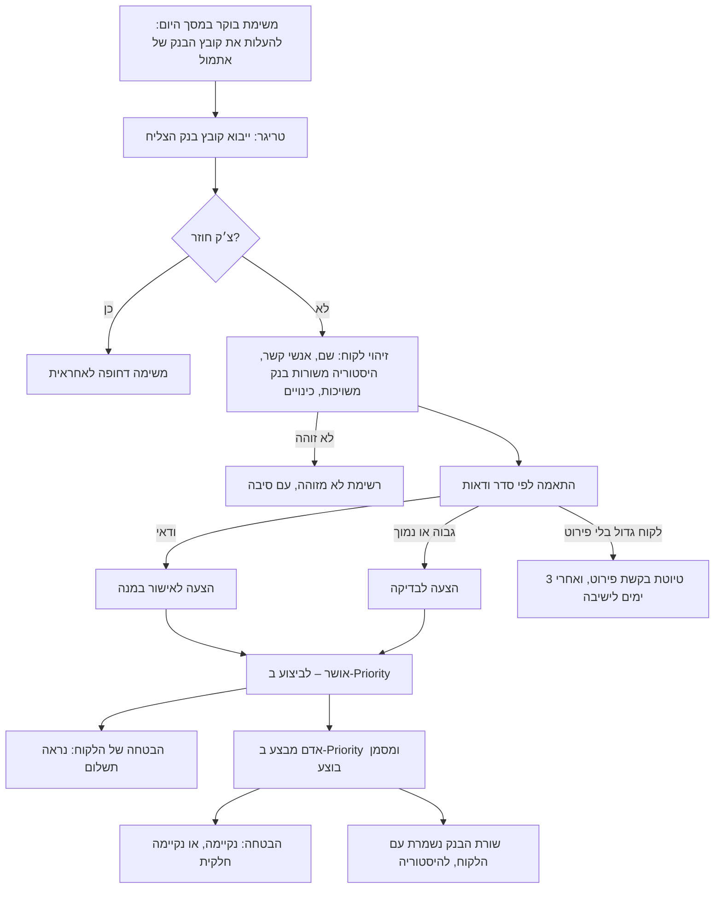

- **התוצר:** הצעות קבלה, רשימת לא מזוהה, טיוטות לבקשת פירוט, כינויים להצעה, ועדכון הבטחות.
- **החלטת המנוע מוסברת בכל הצעה:** "3 חשבוניות, פירעון 30.9, סכום זהה בדיוק".

#### בלוק 3: גיול והבטחות

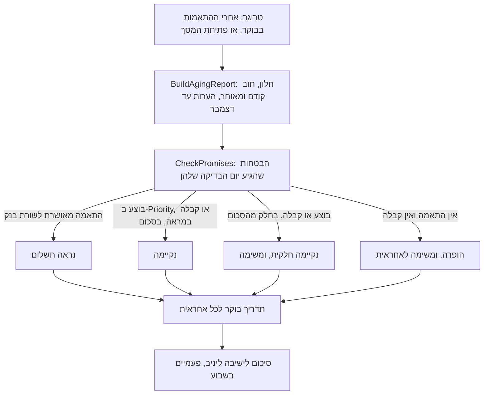

- **התוצר:** טבלת גיול חיה, הערות לפי חודש, סטטוס הבטחות, תדריך בוקר וסיכום לישיבה.
- **אין פנייה ללקוח ואין כתיבה ל-Priority.**

#### בלוק 4: ביטוח אשראי

> **עודכן ב-27.10:** הזרימה שלמטה היא הבסיס, ונורה מריצה אותה מהצ׳אט. הניצול נמדד עכשיו לפי **האובליגו הדינמי** (סטטי, פחות העברות בבירור, פחות קבלות שעוד לא נרשמו ב-Priority). אין מסך נפרד: הלשונית "אובליגו וביטוח" בכרטיס הלקוח, ושתי התראות במסך היום (ניצול גבוה ופקיעה). הפרטים ב-DESIGN_03_CREDIT.md, והפערים ב-GAPS_CREDIT.md.

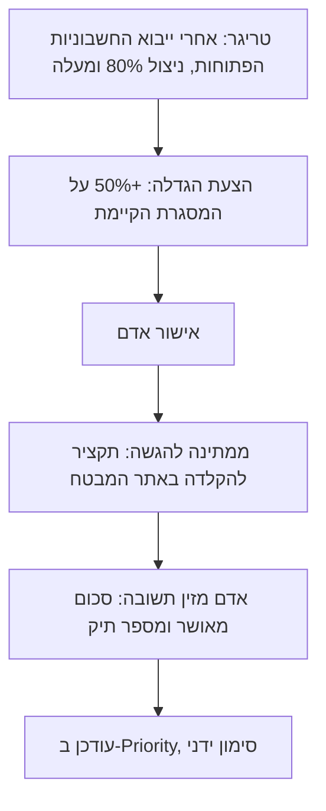

- **בהמשך,** כשיגיע ה-API: S44 יוגש ישירות, ו-S45 ייקלט אוטומטית.
- **ההגדלה האוטומטית** תופעל רק כשיניב "ירגיש בטוח".
- **בקשה ללקוח חדש לא נבנית** בסבב הזה, כי פתיחת לקוחות עוד לא נדונה.
- **השדות שנשלחים למבטח** נשמרים כ-JSON כללי עד שיגיעו השדות המדויקים ממדריך ה-API של ICIC.

### מאיה (CollectionsInboxAgent, חדשה, פרסונה Maya): מענה ושירות

- **אופי עבודה:** יחסים. מנסחת בשם האחראית, ואדם מאשר.
- **מה מפריד אותה מנינה:** מופעלת מכל מייל נכנס ומנסחת מול לקוח ומול גורמים פנימיים.
- **"עבודה טובה":** "לא ליצור מצב שעבר מעל 24 שעות… בלי שיש תגובה". "שהלקוח ידע שבאמת קרן שלחה לו". "הצד השני לא אוהב שאתה משגע אותו".
- **כלים:**
  - GetCustomer360
  - VerifySender
  - ClassifyAndLinkEmail
  - GetLedger
  - GetOpenDebts
  - GenerateStatementPdf (כרטסת או חובות פתוחים)
  - CheckInvoiceDocuments
  - CreateDocumentRequest
  - AnalyzePriceGap
  - CreatePriceApprovalRequest (טיוטת מייל פנימי לסוכן, לא נשלח)
  - RecordPromise
  - LinkRemittance (מעביר מספרי חשבוניות למנוע ההתאמה)
  - CreateReplyDraft
  - CreateTask
- **גבולות:**
  - אף פעם לא שולחת.
  - כרטסת או חובות פתוחים רק לאיש קשר רשום. אחרת יוצרת משימה "לאמת בטלפון".
  - לא מבטיחה זיכוי, הנחה או מועד.
  - בהפרש מחיר תמיד שני אישורים בכתב (סוכן ואחריו מנהל) לפני טיוטת זיכוי, ו"לא סגירת זיכוי". את האישורים מסמנת האחראית עם ראיה. מאיה לא מסמנת אותם בעצמה, גם כשהיא רואה את המייל של הסוכן; היא רק מציעה לאחראית לסמן ומצרפת את המייל.
  - לא מבצעת פולואפ יזום ללקוח. (הסיכום השבועי "נשלח ולא נענה" נדחה.)
  - מייל שסיווגה "לא רלוונטי" נשמר בלי גוף, ומאיה לא מסכמת את התוכן שלו.
  - חותמת בשם האחראית.
- **צ׳אטים:**
  - הצ׳אט במיני-אפליקציה `/maya`.
  - "שאל את מאיה על הפנייה" במגירת הפנייה.

#### השכבה המשותפת (לכל מייל)

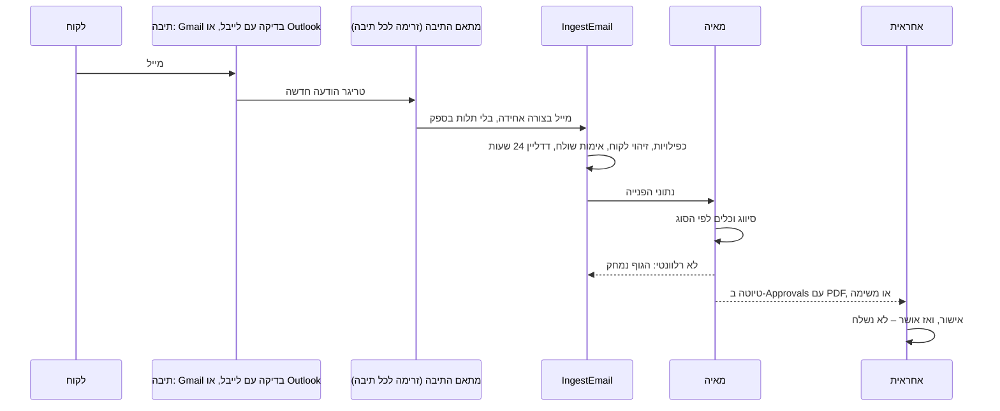

#### 2א כרטסת ו-2ב חובות פתוחים

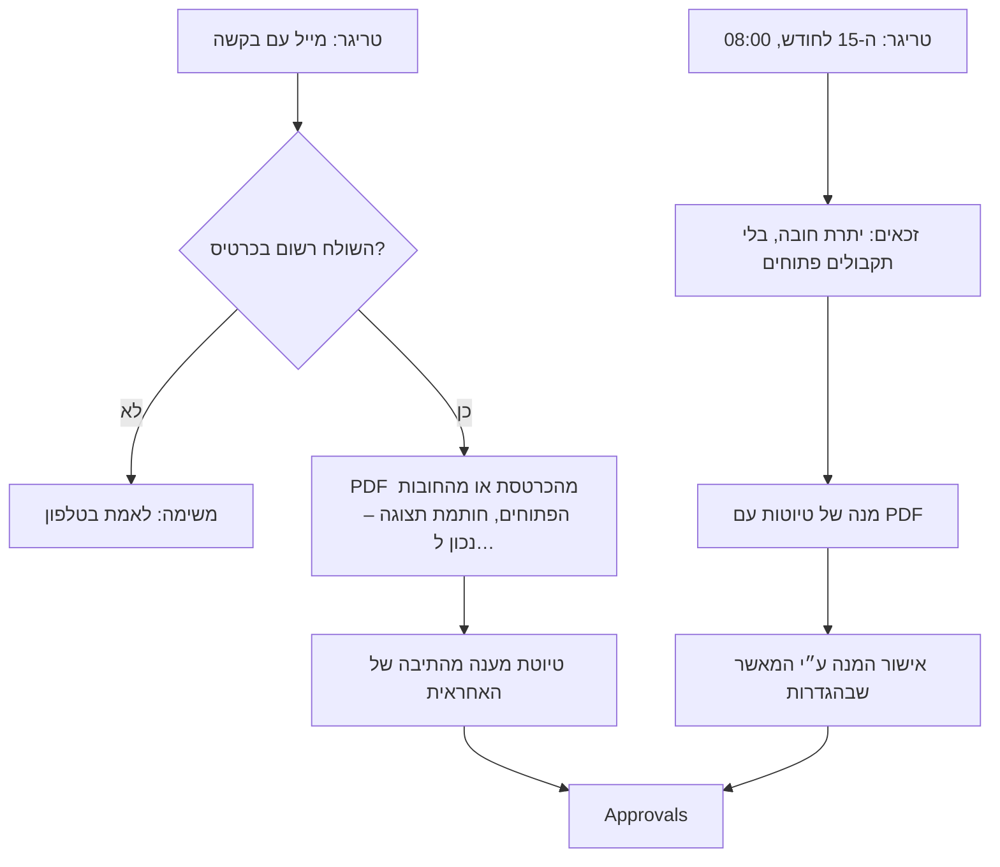

התגובות למנה חוזרות לתור ומסווגות: חסרה חשבונית עוברת ל-2ג, המחיר לא נכון עובר ל-2ד, ו"אשלם ב-X" נרשם כהבטחה.

#### 2ג תעודות וחשבוניות חסרות

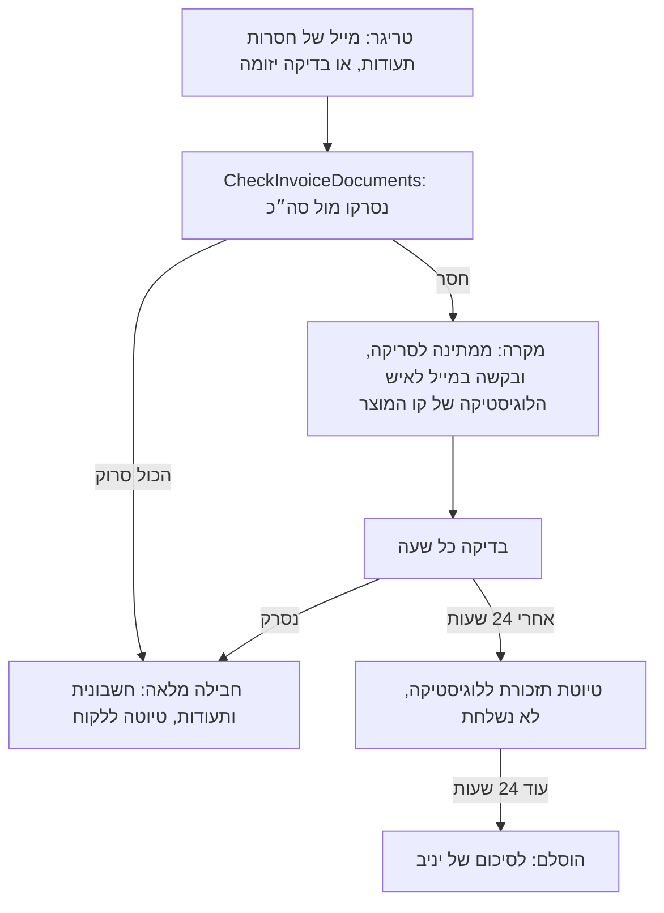

#### 2ד הפרשי מחיר

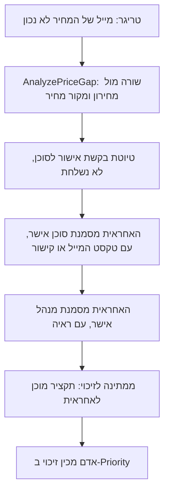

- **כל סימון נשמר** עם מי סימן, מתי והראיה. בלי ראיה הפעולה MarkPriceApproval מסרבת, ו"מנהל אישר" לפני "סוכן אישר" נחסם.
- **תיוג סיבה (בונוס):** מחירון לא עודכן, מחיר ידני, או ללא חיוב.
- **מניעה לפני החשבונית** שייכת למוקד ההזמנות.

### זרימות (workflows)

| Workflow | טריגר | מפעיל |
|--|--|--|
| OnMorningImport | שורה ב-ImportBatches עוברת ל"נכתב" | קובץ בנק: RunMatching, CheckPromises, ואז נינה כותבת תדריך (WriteBriefing). חשבוניות פתוחות: CheckPromises, ProposeInsuranceRequests, ונינה מעדכנת את התדריך |
| MailAdapter-GmailTest | הודעה חדשה ב-Gmail של saar@blocks.diy עם הלייבל Ciment-Test | ממיר לצורה אחידה, IngestEmail, ואחריו מאיה |
| MailAdapter-Outlook-<תיבה> | הודעה חדשה ב-Outlook, אחת לכל תיבה (אחרי האישורים) | אותו IngestEmail ואותה מאיה, בלי שינוי לוגיקה |
| DocumentChase | כל שעה בשעות העבודה | CheckDocumentScans |
| OpenDebtsBatch | לפי openDebtsDay, ב-08:00 | PrepareOpenDebtsBatch |

**אין ריצת בוקר בשעה קבועה** (MorningRun הוסר): הבוקר מתחיל בהעלאת הקבצים. **WeeklyUnanswered נדחה.**

**Code actions** (לכל אחת שכותבת יש `dryRun` ו-`writeVerified`):
- **ייבוא ונתוני בדיקה:** ImportPriorityFile, SeedTestFixtures (סט 10 התרחישים), DeleteTestFixtures, GetMorningChecklist (קריאה בלבד: אילו קבצים חסרים להיום, לפי יום העסקים הקודם).
- **גיול והבטחות:** BuildAgingReport, CheckPromises (כולל "נראה תשלום"), RecordPromise, AddAgingNote.
- **תקבולים:** RunMatching (שלב ההיסטוריה משורות בנק משויכות), DecideMatchProposal (כולל אישור כינוי, "נראה תשלום" בהבטחה, ו"בוצע ב-Priority" שמעביר אותה ל"נקיימה").
- **ביטוח:** ProposeInsuranceRequests. את הסטטוסים מעדכנים ידנית במסך.
- **מיילים:** IngestEmail (הקלט אחיד לכל ספק), VerifySender, ClassifyAndLinkEmail (מוחק גוף כשהסיווג "לא רלוונטי"), GetLedger, GetOpenDebts, GenerateStatementPdf (חותמת תצוגה), PrepareOpenDebtsBatch, LinkRemittance, CreateReplyDraft.
- **מסמכים ומחירים:** CheckInvoiceDocuments, CreateDocumentRequest, CheckDocumentScans, AnalyzePriceGap, CreatePriceApprovalRequest, MarkPriceApproval (ראיה חובה, סדר סוכן ואז מנהל).
- **כלליים:** GetCustomer360, CreateTask, WriteBriefing.
- **לא נבנות בסבב הזה:** SendApprovedMessage ו-PrepareCreditRequest.

## Build order

**הלו״ז:** היום (ד׳ 21.10) איטרציה 4 ואחריה סבב תיקונים. מחר (ה׳ 22.10) יום מלא: 5 ו-6. שבת (24.10) יום מלא: 7 ו-8. ראשון בבוקר, אם צריך: חזרה ותיקונים. **המטרה עד שבת:** בסיס עובד לשיחה עם יניב. בלוק שלא נגמר מוצג כזרימה על נתוני הבדיקה, ולפי סדר העדיפות מוותרים קודם על הסוף (ביטוח, ואז 2ג/2ד).

**למה 4 מתפצלת:** כל התוכן של סבב נכנס לאוויר רק בסוף הסבב. טבלה חדשה קיימת רק אחרי ה-sync, ופעולה חדשה נפרסת רק אחרי ה-sync. לכן אי אפשר להריץ פעולה על טבלה שנוצרה באותו סבב.

1. **Iteration 4a (היום): הסכמה.** כל שינויי הסכמה לארבעת הבלוקים, ב-sync אחד, ושום דבר מלבדם (בלי פעולות, בלי מסכים). בתחילת הסבב הבא: קריאה חוזרת של הסכמה החיה מול הפירוט בסעיף "Iteration 4a" למטה. **בודקים:** קריטריוני הקבלה של 4a.
2. **Iteration 4b (היום): נתוני בדיקה ומנוע הגיול.**
   - SeedTestFixtures מורחבת ל-10 התרחישים (ומחליפה את TEST-001/002), ו-DeleteTestFixtures מורחבת לכל הטבלאות החדשות.
   - BuildAgingReport, CheckPromises, AddAgingNote, RecordPromise, GetMorningChecklist, GetCustomer360.
   - **הרצה:** בסבב שאחרי הפריסה, SeedTestFixtures ב-dryRun (מה ייכתב, לפי טבלה), ורק אחר כך כתיבה אמיתית עם writeVerified (כל שורה נקראת חזרה ונספרת). אחריה BuildAgingReport על הנתונים.
   - **בודקים:** הגיול של כל TEST-00x מחולק נכון לחוב קודם, לחודשי החלון ולחוב מאוחר, והסכום שווה ליתרה. הערות לנובמבר ולדצמבר מופיעות בעמודת "חוב מאוחר". DeleteTestFixtures ב-dryRun מראה שהיא מוחקת בדיוק את מה שנכתב.
3. **Iteration 4c (היום): המסכים.**
   - דוח הגיול עם הערות לפי חודש (כולל עתידי) ומצב ישיבה.
   - יומן ההבטחות עם הסטטוס "נראה תשלום".
   - מסך "היום" עם משימות ההעלאה, מתג שלי / של כולם, כרטיס לקוח 360 (ציר זמן), ומסך הייבוא (מבנה מוכן; כשהאקסל של יניב יגיע, נמפה אותו).
   - הזמנות חסומות יורדות מהתפריט.
   - **בודקים:** ההבטחה מה-10 נראית ב"פתוחה" לפני ההתאמה; משימות ההעלאה מופיעות ונעלמות אחרי ייבוא; "שלי" מסנן לפי האחראית.
   - **ואחריה סבב תיקונים.**
4. **Iteration 5 (מחר): תקבולים ונינה.**
   - ייבוא קובץ בנק, RunMatching (עם שלב ההיסטוריה משורות בנק משויכות) ו-DecideMatchProposal.
   - מסך התקבולים וכינויים.
   - נינה עם כלים, OnMorningImport, תדריך במסך "היום" אחרי ההעלאה, ומיני-אפליקציה `/nina`.
   - **בודקים:** 17,424 מותאם ל-3 חשבוניות. "אבי ובניו" מוצע כגולף. ההבטחה מה-10 עוברת ל"נראה תשלום" ואחרי "בוצע ב-Priority" ל"נקיימה".
5. **Iteration 6 (מחר): שכבת המיילים, 2א ו-2ב.**
   - בתחילתה בודקים שהטריגר של Gmail מסנן לפי הלייבל Ciment-Test, ואם לא, עוברים לבדיקה כל 5 דקות.
   - MailAdapter-GmailTest, IngestEmail ומאיה, מסך הפניות עם טיימר.
   - PDF של כרטסת ושל חובות פתוחים עם חותמת תצוגה, מנת ה-15 לחודש, שער האישור ו"אושר – לא נשלח".
   - **בודקים:** בקשת כרטסת משולח רשום מקבלת טיוטה עם PDF. משולח לא מוכר מקבלת משימה "לאמת". מייל לא רלוונטי נשמר בלי גוף.
6. **Iteration 7 (שבת): 2ג ו-2ד.**
   - מסלול התעודות החסרות עם טיוטות לוגיסטיקה.
   - ניתוח פער מחיר, MarkPriceApproval עם ראיה חובה, ומסך "מסמכים ומחירים".
   - **בודקים:** 4/6 תעודות, אחר כך טיוטת תזכורת, אחר כך סריקה, ואז חבילה מלאה. "מנהל אישר" בלי ראיה, או לפני "סוכן אישר", נחסם.
7. **Iteration 8 (שבת): ביטוח והכנה לשיחה.**
   - מסך הביטוח: הצעות 80%, אישור, ומעקב סטטוס ידני.
   - ליטוש של מסך "היום".
   - חזרה מלאה על התסריט.
   - **בודקים:** לקוח ב-80% מקבל הצעה של 50%.

## Open questions

- **ה-PDF של הכרטסת והחובות הפתוחים:** לדמו מותר, עם חותמת "תצוגה – נכון ל…". פתוח: האם מסמך שמופק אצלנו מקובל ללקוח בפועל, או שחייבים את המסמך המקורי מ-Priority? (סער ויניב)
- **מתי ואיך שולחים בפועל:** בסבב הזה הכול נעצר ב"אושר – לא נשלח", ופעולת שליחה לא נבנית. (סער)
- **מי מאשר את המנה של ה-15:** יניב או האחראית. נבנה כהגדרה, וברירת המחדל היא יניב. (יניב)
- **רדיפה אוטומטית אחרי הלוגיסטיקה מהיום הראשון?** נבנה כהגדרה, וברירת המחדל היא טיוטה. גם אם תופעל, בסבב הזה היא מייצרת טיוטה, כי שליחה לא נבנית. (יניב)
- **כמה מנהלות חשבונות בפועל (2 או 3), ואיך מחולקים הלקוחות.** האפליקציה תעבוד בשני המצבים. (יניב)
- **אחרי כמה זמן מסלימים לקוח גדול בלי פירוט, ולמי.** 3 ימי עסקים, לסיכום של יניב. מסומן בהגדרות כ"הנחה". (יניב)
- **פתיחת לקוחות ובקשת ביטוח ללקוח חדש:** לא נדון, ולכן לא נבנה. (יניב)
- **ספים להסלמת הבטחות** ליניב או לסוכן, ו"חוקי החשיבה" לגיול. (יניב)
- **דחייה חלקית מהמבטח:** מה עושים. (יניב)
- **לקוחות מזומן:** בסקופ או לא. (יניב)
- **הרשאה לקרוא את כל המיילים בתיבות העבודה:** אישור של אבי ושל גילה, ושיטת החיבור (חיבור לכל תיבה, או הרשאת אפליקציה מ-IT). (סער מול גילה ונווית)
- **מבנה הקבצים:** אקסל הגיול, קובץ הבנק של מזרחי, מייל פירוט תשלום, צילום כרטיס לקוח. (יניב, לפי המייל מ-21.10)
- **השמות של המסכים והדוחות ב-Priority, ומיפוי המראות לישויות של ה-API.** (נווית)
- **ה-API של בסס״ח:** תיעוד, טוקן ורשימת השדות המדויקת לבקשת מכסה. סער שולח את השדות בהודעה נפרדת, מתוך מדריך ה-API של ICIC. עד אז insurerFields כללי. (סער)
- **הטריגר של Gmail:** האם הוא מסנן לפי לייבל. נבדק בתחילת איטרציה 6, ויש גיבוי. (Ella)

## מצב נוכחי (read-back מהאפליקציה החיה)

**עמודים (9 ועוד 404):**
- `/` תור היום
- `/approvals` אישורים
- `/customers` לקוחות
- `/customers/[code]` כרטיס לקוח
- `/invoices` חשבוניות
- `/promises` הבטחות תשלום
- `/disputes` מחלוקות
- `/blocked-orders` הזמנות חסומות
- `/settings` הגדרות
- `not-found`

**טבלאות (13):**
- **Customers** (מפתח customerCode): customerCode, customerName, customerType (אשראי, מזומן), priorityStatus (פעיל, זמני, חסום), paymentTermsDays, paymentTermsLabel, creditLimit, obligoUsed, obligoPct, creditInsurer, insuranceApprovedAmount, salesAgentName, salesAgentPhone, apContactName, apContactEmail, apContactPhone, procurementContactName, procurementContactEmail, procurementContactPhone, assignedBookkeeperName, preferredChannel (דואל, WhatsApp, טלפון), doNotContact, collectionStage (תקין, תזכורת, פנייה שנייה, שיחה, הוסלם למנהל), lastPaymentDate, internalNotes, source, syncedAt.
- **Invoices** (מפתח invoiceNumber): invoiceNumber, customerCode, customerName, salesAgentName, invoiceDate, dueDate, dueMonth, amount, openAmount, status (פתוחה, שולמה חלקית, שולמה, בזיכוי), deliveryNotesExpected, deliveryNotesAttached, missingDeliveryNotes, hasZeroPriceLines, source, syncedAt.
- **DeliveryNotes** (מפתח noteNumber): noteNumber, invoiceNumber, customerCode, customerName, siteName, deliveryDate, scanned, signed, source, syncedAt.
- **Payments** (מפתח paymentRef): paymentRef, customerCode, customerName, paymentDate, amount, method (העברה בנקאית, צ׳ק, צ׳ק דחוי, כרטיס אשראי), checkDueDate, matchedInvoiceNumbers, matchStatus (מותאם, מותאם חלקית, לא מותאם), source, syncedAt.
- **BlockedOrders** (מפתח orderNumber): orderNumber, customerCode, customerName, orderAmount, blockedAt, blockReason (חריגת אובליגו, לקוח חסום, אחר), salesAgentName, released, source, syncedAt.
- **CollectionQueue:** queueDate, customerCode, customerName, assignedBookkeeperName, priorityScore, reasons, recommendedAction (7 ערכים), status (ממתין, בטיפול, טופל, נדחה), handledBy, handledAt.
- **Interactions:** customerCode, customerName, occurredAt, type (דואל, WhatsApp, שיחה, הערה, תשלום, הבטחה, מחלוקת, הסלמה), direction (יוצא, נכנס, פנימי), actorName, summary, relatedInvoiceNumbers.
- **PaymentPromises:** customerCode, customerName, promisedAmount, promisedDate, method, invoiceNumbers, status (פתוחה, נקיימה, נקיימה חלקית, הופרה), recordedBy, recordedAt, checkedAt.
- **Disputes** (מפתח disputeNumber): disputeNumber, customerCode, customerName, disputeType (מחיר, תעודת משלוח חסרה, סחורה או החזרה, ממתין לאישור רכש, אחר), invoiceNumbers, disputedAmount, description, ballWith (6 ערכים), ownerBookkeeperName, status (פתוחה, בטיפול, ממתינה לזיכוי, נסגרה), openedAt, closedAt, resolution.
- **Approvals:** customerCode, customerName, kind (דואל, WhatsApp, שיחה, בקשת זיכוי, הסלמה, בקשת הגדלת מסגרת), recipientName, recipientContact, subject, body, reason, status (ממתין, אושר, נדחה, נשלח), draftedBy, draftedAt, decidedBy, decidedAt, decisionNote.
- **CreditLimitRequests:** customerCode, customerName, currentLimit, obligoPct, requestedLimit, justification, status (טיוטה, הוגשה למבטח, אושרה, נדחתה), requestCreatedAt.
- **EscalationRules:** stage, minDaysOverdue, minOpenAmount, channel, waitDaysBeforeNext, requiresApproval.
- **TeamMembers:** name, role (מנהלת חשבונות, מנהל גבייה, סמנכ״ל כספים), email, active.

**Actions:** SeedTestFixtures ו-DeleteTestFixtures (code). **Iteration 2a בוצעה:** TEST-001 ו-TEST-002 קיימים בנתונים מ-12.10. **הסוכנת:** CollectionsAgent (נינה), עם `tools` ריק ובלי צ׳אט. **מיני-אפליקציות:** אחת, `/` "גבייה". **Views ו-workflows:** אין.

## פער לפי בלוק

| בלוק | קיים | חסר: טבלאות | חסר: לוגיקה (code actions) | חסר: מסכים |
|--|--|--|--|--|
| 1 תקבולים | Payments (קבלות), Customers | BankLines, BankAliases, MatchProposals, CustomerContacts. שדות ב-Payments | **RunMatching** (זיהוי ב-4 שלבים, התאמה לפי סדר ודאות), **DecideMatchProposal** | `/receipts` וכינויים, ונתח במסך "היום" |
| 2 מיילים | Approvals, Disputes, DeliveryNotes, Invoices | InboundEmails, CustomerContacts, LedgerEntries, InvoiceLines, PriceListItems, ProductLineContacts. הרחבות ב-Disputes וב-Approvals | **VerifySender**, **GenerateStatementPdf**, **PrepareOpenDebtsBatch** (זכאות), **CheckDocumentScans** (טיימרים), **AnalyzePriceGap** (שורה מול מחירון) | `/inbox`, `/inbox/open-debts`, `/disputes` מחודש |
| 3 גיול | Invoices (dueDate, openAmount), PaymentPromises, Interactions | AgingNotes, CustomerOwners, AgentBriefings. שדות בהבטחות | **BuildAgingReport** (חלון, חוב קודם ומאוחר, לפי פירעון), **CheckPromises** (מלא, חלקי, הופר) | `/aging` ומצב ישיבה, `/promises` כיומן, ציר זמן 360 |
| 4 ביטוח | CreditLimitRequests, Customers (obligoPct, insuranceApprovedAmount) | שדות בבקשות ובלקוח (ח״פ, מסגרת מבוטחת) | **ProposeInsuranceRequests** (סף 80%, +50%) | `/insurance` |
| משותף | TeamMembers, הגדרות | AgentSettings, ImportBatches | ImportPriorityFile, נתוני בדיקה מורחבים | `/settings/imports`, מתג שלי / כולם |

## מה לא אפשרי בפלטפורמה, ומה דורש החלטה שלכם

- **ערוץ המייל המובנה של סוכן לא יכול לעכב תשובה לאישור,** ולכן לא משתמשים בו. ההאזנה תהיה דרך טריגר התיבה וזרימה (מתאם). עכשיו Gmail של בדיקה, ובהמשך Outlook. לגבי Outlook צריך לבדוק שהטריגר תומך בכמה תיבות.
- **טבלה ופעולה חדשות קיימות רק אחרי sync,** ולכן הסכמה, ההרצה והמסכים של איטרציה 4 מתפצלים לסבבים נפרדים.
- **אין חיבור ישיר לבנק.** קובץ הבנק עולה ידנית, או מגיע מ-Priority כשיהיה API.
- **ל-Priority יש חיבור מובנה בפלטפורמה.** נשתמש בו כשגילה תגדיר טוקן וסביבת Test. עד אז, קבצים.
- **לבסס״ח אין חיבור מובנה.** נבנה code action עם מפתח, אחרי שנקבל את תיעוד ה-API.
- **WhatsApp ללוגיסטיקה ולסוכנים:** דורש מספר WhatsApp Business מחובר. נדחה לסבב הבא.
- **view לא מקבל פרמטרים,** ולכן הגיול מחושב ב-code action. רשימות שמתעדכנות בזמן אמת נקראות מהטבלאות ולא מ-views.
- **המעבר לחשבון Blocks של סימנט** (שתי האפליקציות באותו חשבון) הוא העתקה של כל ה-artifacts והקוד. יתוכנן לפני העלייה לאוויר.

## Risks

- **מבנה הקבצים לא ידוע** (אקסל הגיול, קובץ הבנק). את המיפוי אפשר לסגור רק כשהם מגיעים. עד אז עובדים על נתוני הבדיקה.
- **הרשאה לקרוא מיילי עבודה אישיים** דורשת אישור של אבי ושל גילה, ובדיקת אבטחה (דן). עד האישור, בלוק המיילים עובד על תיבת הבדיקה Gmail של סער, רק עם הלייבל Ciment-Test.
- **הזמן קצר:** שבעה סבבים בשלושה ימי עבודה. אם צריך לקצץ, הולכים לפי סדר העדיפות: קודם ביטוח, ואחריו 2ג/2ד, שיוצגו כזרימה על נתוני הבדיקה. אחר כך מוותרים על הליטוש. גיול, הבטחות ותקבולים לא מתקצצים.

## Iteration 4a: הסכמה המלאה וקריטריוני קבלה

**מה נכנס לסבב:** רק קבצי הטבלאות (14 חדשות ו-9 מורחבות), ו-`pnpm gen:types`. אין פעולות, אין views, אין סוכנות, אין זרימות ואין שינוי מסכים. האפליקציה נראית אותו דבר אחרי הסבב. ה-views נכנסים ב-4b, כי הם קוראים טבלאות שצריכות להתקיים קודם.

**כללים לכל הטבלאות:**
- רק הוספה: לא מוחקים עמודה קיימת, לא משנים סוג, ולא מוחקים ערך קיים מרשימה. ערכים קיימים שלא בשימוש נשארים.
- בלי עמודות reference. קישורים בטקסט: customerCode, invoiceNumber, ומזהה רשומה כטקסט (relatedId, bankLineId וכו׳).
- שמות לתצוגה בכל שורה שסוכנת קוראת: customerName, ולפי הצורך bookkeeperName, salesAgentName, logisticsOwnerName.
- בלי ' או " בערכי רשימה. משתמשים ב-׳ ו-״, ו"מייל" כערך הוא דואל.
- אין עמודה בשם createdAt.
- סכומים number בש״ח, תאריכים date, חותמות זמן datetime.
- **מראה** (נתון שמגיע מ-Priority או מהבנק): source (priority-mock, priority-file, priority-api, test-fixture) ו-syncedAt, מפתח ייחודי ו-upsert, כדי שה-API יחליף את הקבצים לפי אותו מפתח.
- **טבלה שלנו:** עמודה isTestFixture (boolean). הכותבים תמיד ממלאים אותה, כי לפלטפורמה אין ברירות מחדל. DeleteTestFixtures מוחקת לפי `isTestFixture = true` או `source = test-fixture`, בפעולה אחת.

### טבלאות קיימות שמתרחבות (רק מה שנוסף)

| Table | עמודה חדשה | סוג | הערה |
|--|--|--|--|
| Customers | companyId | string | ח״פ |
| | primaryEmail | string | המייל הכללי בכרטיס |
| | priceListCode | string | המחירון של הלקוח |
| | ledgerBalance | number | יתרת כרטיס מ-Priority |
| | insurerCaseNumber | string | מספר תיק אצל המבטח. המסגרת המבוטחת נשארת insuranceApprovedAmount |
| Invoices | documentType | string, רשימה | חשבונית, חשבונית זיכוי |
| | sourceDocUrl | string | קישור למקור החשבונית |
| | productLine | string | קו מוצר, לניתוב ללוגיסטיקה |
| DeliveryNotes | productLine | string | |
| | scanUrl | string | |
| | scannedAt | datetime | |
| Payments | receiptNumber | string | מספר קבלה ב-Priority |
| | bankLineId | string | שורת הבנק שממנה נבנתה הקבלה |
| PaymentPromises | promiseSource | string, רשימה | שיחה, דואל, ישיבה, ייבוא |
| | assignedBookkeeperName | string | |
| | checkOn | date | יום העסקים שאחרי תאריך ההבטחה |
| | seenAt, seenBankLineId, matchProposalId | datetime, string, string | מתי ואיפה "נראה תשלום" |
| | matchedReceiptRefs, matchedAmount, keptAt | string, number, datetime | הקבלה שסגרה את ההבטחה |
| | inboundEmailId | string | כשההבטחה הגיעה במייל |
| | isTestFixture | boolean | |
| | status, ערך חדש | רשימה | + **נראה תשלום** (בין פתוחה לנקיימה) |
| Disputes | inboundEmailId, missingNoteNumbers, productLine | string | |
| | logisticsOwnerName, logisticsOwnerEmail | string | |
| | nextReminderAt, reminderCount | datetime, number | |
| | salesAgentName, salesManagerName | string | |
| | salesAgentApprovedAt, salesAgentApprovalMarkedBy, salesAgentApprovalEvidence | datetime, string, string | הראיה היא טקסט המייל או קישור |
| | salesManagerApprovedAt, salesManagerApprovalMarkedBy, salesManagerApprovalEvidence | datetime, string, string | |
| | creditDraftNote | string | התקציר לזיכוי |
| | isTestFixture | boolean | |
| | status, ערכים חדשים | רשימה | + ממתינה לסריקה, תזכורת בטיוטה, הוסלמה, ממתינה לאישור סוכן, ממתינה לאישור מנהל, מוכנה לשליחה ללקוח. הסוגים הקיימים "תעודת משלוח חסרה" ו"מחיר" משמשים ל-2ג ול-2ד |
| Approvals | relatedTable, relatedId | string | הרשומה שהטיוטה שייכת אליה |
| | fromMailbox | string | התיבה של האחראית |
| | attachmentUrls | string | קישור בכל שורה |
| | batchId, inboundEmailId | string | |
| | isTestFixture | boolean | |
| | kind, ערכים חדשים | רשימה | + מענה ללקוח, בקשת פירוט, מנת חובות פתוחים, פנייה ללוגיסטיקה, בקשת אישור מחיר, הצעת קבלה |
| | status, ערכים חדשים | רשימה | + אושר – לא נשלח, אושר – לביצוע ב-Priority, בוצע |
| CreditLimitRequests | triggeredAtPct | number | הניצול כשההצעה נוצרה |
| | companyId, currency | string | |
| | insuredLimitAtRequest | number | |
| | insurerFields | object (JSON פתוח) | כללי עד מדריך ICIC |
| | assignedBookkeeperName, proposedBy, decidedBy | string | |
| | decidedAt, submittedAt | datetime | |
| | approvedAmount | number | |
| | insurerCaseNumber, insurerResponseNote | string | |
| | isTestFixture | boolean | |
| | status, ערכים חדשים | רשימה | + הוצעה ע״י הסוכנת, ממתינה להגשה, אושרה חלקית, עודכן ב-Priority |
| CollectionQueue | taskType | string, רשימה | צ׳ק חוזר, לא מזוהה, התאמה לבדיקה, הבטחה הופרה, לאמת שולח, פירוט לא התקבל, ביטוח 80%, אחר |
| | relatedTable, relatedId | string | |
| | dueAt | datetime | |
| | isTestFixture | boolean | |

**בלי שינוי:** Interactions, TeamMembers, BlockedOrders, EscalationRules.

### מראות חדשות (source ו-syncedAt בכל אחת, upsert לפי המפתח)

| Table | מפתח | עמודות (סוג) |
|--|--|--|
| CustomerContacts | contactKey | contactKey, customerCode, customerName, contactName, email, phone (string). roleFlags (string, ערכים מופרדים בפסיק: הנהלת חשבונות, רכש, ראשי, אחר) |
| BankLines | bankLineId | bankLineId, payerName, reference, bankAccount, importBatchId (string). bankName (רשימה: מזרחי, בינלאומי, אחר). valueDate (date). amount (number). lineType (רשימה: העברה, צ׳ק, צ׳ק חוזר, אחר). customerCode, customerName (string, נכתבים כשהתאמה מאושרת, ומזינים את שלב "היסטוריה"). status (רשימה: חדשה, יש הצעה, לבדיקה, לא מזוהה, אושרה – לביצוע ב-Priority, בוצעה ב-Priority) |
| LedgerEntries | entryKey | entryKey, customerCode, customerName, docType, docNumber, details (string). entryDate, valueDate (date). debit, credit, runningBalance (number) |
| InvoiceLines | lineKey | lineKey, invoiceNumber, orderNumber, customerCode, customerName, salesAgentName, sku, itemName, managerApprovalStatus, freeText (string). quantity, unitPrice, lineTotal (number). priceSource (רשימה: הזמנה, מחירון, ידני) |
| PriceListItems | priceKey | priceKey, priceListCode, customerCode, customerName, siteName, sku, itemName (string). price (number). validFrom, validTo (date) |

### טבלאות חדשות שלנו (isTestFixture בכל אחת)

| Table | מפתח | עמודות (סוג) |
|--|--|--|
| BankAliases | bankName | bankName, customerCode, customerName, proposedFromBankLineId, approvedBy (string). status (רשימה: מוצע, מאושר, נדחה). proposedAt, approvedAt (datetime) |
| MatchProposals | אין | bankLineId, payerName, customerCode, customerName, invoiceNumbers, reasoning, assignedBookkeeperName, decidedBy, priorityDoneBy (string). valueDate (date). amount (number). allocations (object: שורות של חשבונית וסכום). customerIdMethod (רשימה: שם זהה, איש קשר, היסטוריה, כינוי, ידני). matchMethod (רשימה: מספרי חשבוניות מפירוט, סכום = פירעון זהה, סכום ייחודי, ידני). confidence (רשימה: ודאי, גבוה, נמוך). status (רשימה: מוצעת, אושרה – לביצוע ב-Priority, בוצעה ב-Priority, נדחתה, הוחלפה). proposedAt, decidedAt, priorityDoneAt (datetime) |
| InboundEmails | messageId | messageId, threadId, mailbox, mailboxOwnerName, sourceLabel, fromAddress, fromName, subject, bodyText, customerCode, customerName, mentionedInvoiceNumbers, attachmentNames, attachmentUrls, assignedBookkeeperName, agentSummary (string). mailProvider (רשימה: gmail, outlook). bodyStored (boolean). receivedAt, dueAt, answeredAt (datetime). senderVerification (רשימה: מאומת, לא מאומת, לבדיקה). category (רשימה: כרטסת, חובות פתוחים, תעודות וחשבוניות חסרות, הפרש מחיר, פירוט תשלום, הבטחת תשלום, אחר, לא רלוונטי). status (רשימה: חדשה, בטיפול מאיה, טיוטה מוכנה, ממתינה לגורם פנימי, נענתה, לא רלוונטית) |
| AgingNotes | אין (היסטוריה) | customerCode, customerName, noteText, authorName, importBatchId (string). monthKey (string: YYYY-MM לכל חודש, כולל עתידי, או "חוב קודם" או "חוב מאוחר"). writtenAt (datetime). noteSource (רשימה: אפליקציה, ייבוא אקסל, ישיבה) |
| ProductLineContacts | productLine + email | productLine, logisticsOwnerName, email, phone (string). active (boolean) |
| CustomerOwners | customerCode | customerCode, customerName, bookkeeperName, setBy (string). setAt (datetime) |
| AgentSettings | settingKey | settingKey, value, label, description (string). valueType (רשימה: מספר, טקסט, כן או לא). basis (רשימה: החלטת יניב, הנחה, ברירת מחדל) |
| AgentBriefings | אין | agentName, audience, headline, body, triggeredByImportId (string). briefingDate (date). counts (object). briefingCreatedAt (datetime) |
| ImportBatches | אין | fileName, fileUrl, uploadedBy, errors (string). kind (רשימה: דוח גיול, קובץ בנק, חשבוניות פתוחות, כרטיסי לקוח, אנשי קשר). dataDate (date). uploadedAt (datetime). rowsRead, rowsWritten (number). status (רשימה: נקרא, נכתב, נכשל) |

**סה״כ אחרי 4a:** 27 טבלאות (13 קיימות ו-14 חדשות). ערכי הפתיחה של AgentSettings נכתבים ב-4b כנתונים אמיתיים (isTestFixture=false), לא כנתוני בדיקה.

### קריטריוני קבלה של 4a

1. `pnpm gen:types` עובר בלי שגיאות. ב-`src/product-types.ts` יש Entity לכל אחת מ-27 הטבלאות.
2. **קריאה חוזרת של הסכמה החיה** (TablesDescribe, בתחילת הסבב הבא) מול הטבלאות שלמעלה: לכל טבלה אותן עמודות, אותם סוגים, אותם ערכי רשימה ואותו מפתח ייחודי. אפס הבדלים. כל הבדל מתוקן לפני 4b.
3. אין עמודה קיימת שנמחקה או ששינתה סוג, ואין ערך רשימה קיים שנמחק. TEST-001 ו-TEST-002 עדיין נקראים.
4. בכל מראה יש source, syncedAt, מפתח ייחודי ו-upsert. בכל טבלה חדשה או מורחבת שלנו יש isTestFixture.
5. אין עמודת reference, אין עמודה בשם createdAt, ואין ' או " בשום ערך רשימה.
6. בכל טבלה שסוכנת קוראת יש customerName ליד customerCode, ושם לתצוגה ליד כל שדה של אדם.
7. לא נוצרו פעולות, views, זרימות או סוכנות, והמסכים לא השתנו.

## Note (25.10.2026), Priority sync strategy — documentation only
Saar's spec "סנכרון עם Priority: אסטרטגיה אחת לכל האפליקציה". One cross-component Design doc (memories/files/DESIGN_SYNC.md, Design tab "סנכרון עם Priority") replaces each component's own sync wording; 01/02/03 carry a pointer line. Gaps got a "סנכרון עם Priority" tab (memories/files/GAPS_SYNC.md); the aging and credit sync lines became pointers. Nothing built: no sync, no "עודכן מ-Priority ב-…" label, no refresh button. Building the five mechanisms waits for Priority API access (Navit questions: delta pull, push notifications, rate limit).
Audit of 25.10 (reported to Saar, NOT yet fixed — wait for their decision): 02 says "נמשך אוטומטית מ-Priority" and the aging screen header says so too, while no pull exists (test data only); diagram 02 block 1 says TODO. Also: promises checked against Payments/MatchProposals, not receipts; Maya can re-run CheckBankLine via LinkRemittance without a click (undocumented); note-combining also uses "שולם לטענת הלקוח"; customer reply is rung 0; "חיפוש נוסף", 60-day note window, ±1 ₪ tolerance undocumented; diagram 02 block 7 GetWeekBrief is code not AI; 01 block 4 feedback is written by RecordAgentFeedback; 03 block 7 nothing writes Approvals.
