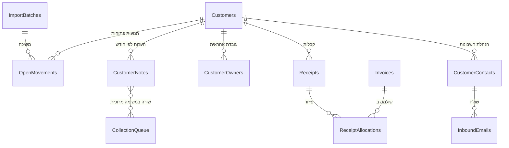
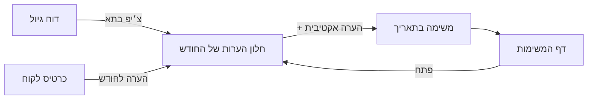
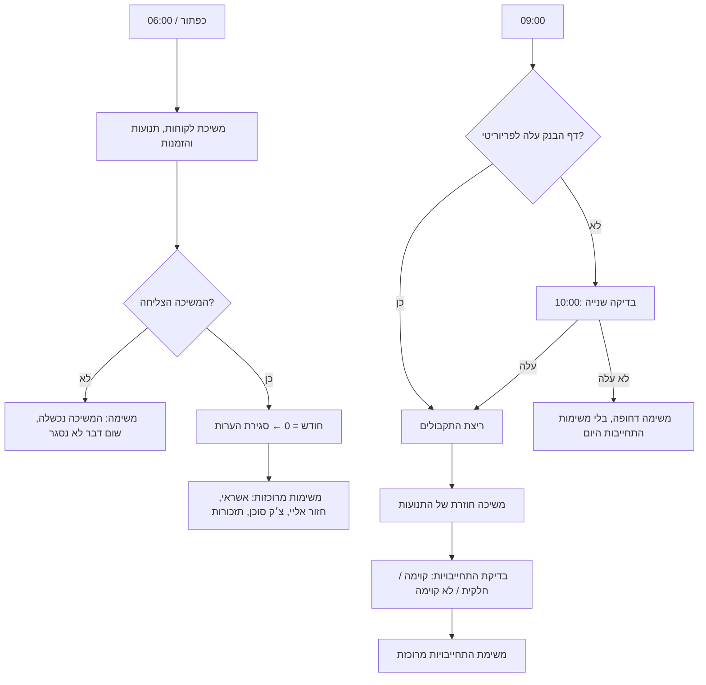
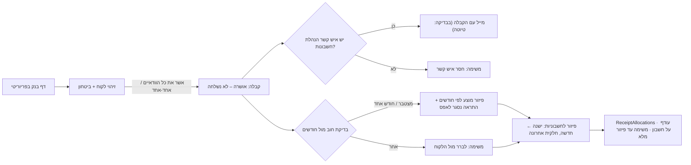

# Plan: גיול, תקבולים ופניות מחדש (אחרי דיסקברי 3, 04.11) · revision 2

שלושה חלקים, לפי הסדר: **א' דוח גיול ויסודות הנתונים** → **ב' תקבולים** → **ג' פניות**. כל חלק נבנה רק אחרי שהקודם עלה לחי.

## Understanding

**You said:** כל הממשק של דוח הגיול לפי חשבונית לא נכון. דוח הגיול הוא התנועות שלא הותאמו בפריוריטי לפי חודש פירעון: עמודה לכל חודש עם סה״כ ומקום להערות, בלי חשבוניות. הוא נמשך מפריוריטי כל בוקר ב-06:00, ויש גם כפתור למשיכה מיידית. ההערות נשמרות לפי כרטיס לקוח: לקוח (קישור אמיתי לשורת הלקוח), תאריך יצירה, החודש שלגביו ההערה תקפה, תוכן וסוג. יש סוגים אקטיביים שיוצרים משימה, וכל השאר בחירה חופשית וטקסט חופשי:
- התחייבות לתשלום יוצרת משימה "ליצור קשר לבירור" מהיום שאחרי התאריך. בעתיד אולי גם מייל אוטומטי.
- תשלום באשראי יוצר משימה "להתקשר ולקחת פרטי אשראי" ביום עצמו.
- צ׳ק אצל סוכן וחזור אליי: כן, צ׳ק אצל סוכן דורש העמקה ונרשם בפערים.
- כל הערה יכולה לקבל תאריך תזכורת.

הערה נסגרת אוטומטית רק כשהחוב של אותו חודש מגיע ל-0 ₪, וגם אז היא נשמרת בהיסטוריה. הערות מוצגות כמו כרטיסיות בתוך החודש: מונה, וחלון צף קטן עם הפרטים. פריוריטי נשאר מקור האמת. אצלנו יש עותק כדי שהאפליקציה תהיה מהירה, ועליו ההעשרה שלנו. המשיכה כותבת רק לטבלאות המראה ולא מוחקת שורות שמקושרות אלינו, כמו הלקוח שההערות תלויות בו. ה-DB מצטמצם. כל מה שנבנה לחשבוניות צריך עבודה מחדש בשיחה נפרדת על חשבוניות ותקבולים, ואין לזה קשר לדוח הגיול. בכרטיס הלקוח עדיין רואים את כל החשבוניות. הפערים מתאפסים ונכתבים מחדש בסוף סבב השינויים של השבוע.

**ב-revision 2 הוספת:**
- **חלק א':** קבלה על חלק מחשבונית אפשרית (נדיר) ונתמכת. משימות מרוכזות: משימה אחת לכל סוג + תאריך + עובדת, עם שורה לכל לקוח. outcome עם "קוימה חלקית". לוח זמנים 06:00 / 09:00 / 10:00, תלוי בדף הבנק בפריוריטי, וכל השעות כהגדרות. בפערים התוכן הישן עובר לארכיון ולא נמחק. זיכויים והפרשי מחיר, וחשבוניות ותעודות חסרות, נרשמים כשיחות נפרדות.
- **חלק ב', תקבולים:** מתחילים כשדף הבנק עולה לפריוריטי. זיהוי לקוח אוטומטי עם רמת ביטחון. אישור הלקוח מוציא את הקבלה ושולח אותה להנהלת החשבונות של הלקוח. מיד אחר כך בדיקת חוב מול חודשי הפירעון, ופיזור לחשבוניות כשלב נפרד שלא חוסם. שני ספים אוטומטיים, כבויים בהתחלה. צ׳קים של סוכנים עוברים את אותו מסלול.
- **חלק ג', פניות:** תיבה אחת (קרן), מייל בלבד. זיהוי לפי אנשי קשר של הנהלת חשבונות, ושולח לא מוכר מזוהה מהחתימה. שתי קטגוריות עם תשובה ב-PDF (כרטסת, חובות פתוחים). השליחה החודשית ב-5 לחודש. מייל עם התחייבות יוצר הערה. אישורי ביטוח מבסס״ח. כל השאר מסווג ונפתחת משימה ידנית.

**I assumed:**
- הריצות רצות א׳–ה׳, ומחליפות את TaskScan.
- עד שיש API, מקור הבדיקה של "תנועות פתוחות" נבנה מנתוני הבדיקה הקיימים, כך שהסכומים בדוח ובכרטיס זהים.
- המשימות מוקצות לעובדת של הלקוח (CustomerOwners).
- צ׳ק אצל סוכן פותח משימה אחרי 2 ימים (הגדרה) אם החודש לא התאפס.
- הערה שייכת לחודש אחד.
- "נכנס" בהתחייבות = כל הקבלות של הלקוח מאז שההערה נכתבה: קבלות מפריוריטי, ועד שיש API גם הקבלות שאושרו אצלנו. "הובטח" = סכום ההערה, ואם אין סכום, יתרת החודש ביום שההערה נכתבה.
- "דף הבנק עלה לפריוריטי" = יש בפריוריטי שורות בנק עם תאריך של יום העסקים הקודם. עד שיש API, זה נבדק מול מקור הבדיקה של SyncPriorityBankLines.
- הקבלה שנשלחת ללקוח היא PDF שהאפליקציה מפיקה, עד שיש API. אחרי זה נשלחת הקבלה של פריוריטי.
- איש קשר של הנהלת חשבונות מסומן ב-isApContact, שכבר קיים בטבלת אנשי הקשר.

**Success:**
- **א':** דוח הגיול מציג לכל לקוח סה״כ פתוח לכל חודש פירעון, עם צ׳יפ הערות בכל תא, והוספת הערה נעשית מהתא. משיכת הבוקר והכפתור מעדכנות את הסכומים, וחודש שהתאפס סוגר את ההערות שלו. כל בוקר נפתחת משימה מרוכזת אחת לכל סוג, תאריך ועובדת, עם שורה לכל לקוח. משימות ההתחייבות נפתחות רק אחרי ריצת התקבולים, ואם דף הבנק לא עלה עד 10:00, נפתחת משימה דחופה. דף ה-Design מתאר את המודל החדש. בדף הפערים יש לשונית ארכיון, ולשונית גיול חדשה.
- **ב':** כשדף הבנק עולה, כל השורות מקבלות לקוח עם רמת ביטחון. בלחיצה אחת מאשרים את כל הוודאיים, ואת השאר אחד-אחד. אישור מוציא קבלה, ובבדיקה היא לא נשלחת. בדיקת החוב מציעה פיזור לפי חודשים או פותחת משימת בירור. הפיזור לחשבוניות מציע מהישנה לחדשה, תומך בחשבונית חלקית ובכמה קבלות לחשבונית, ומשאיר משימה עד שהקבלה מפוזרת כולה.
- **ג':** מייל מאיש קשר מוכר שמבקש כרטסת או חובות פתוחים מקבל טיוטת תשובה עם PDF, שיוצאת בלחיצה. שולח לא מוכר פותח משימה "זה הלקוח X?". השליחה החודשית רצה ב-5 לחודש.

## Decisions

- **App purpose:** production, כמו שרשום ב-STORY. דמו היה מוותר על המשיכה ועל המיגרציה ומסתפק בנתוני דוגמה.

### חלק א' · דוח גיול ויסודות הנתונים

- **דוח הגיול נבנה מתנועות, לא מחשבוניות.** מראה חדשה, OpenMovements: התנועות שלא הותאמו לכל לקוח, לפי חודש פירעון. נדחה: להמשיך לחשב מחשבוניות עם openAmount, כי נווית הסבירה שזה לא מה שפריוריטי מציג. זה כולל קבלות על חשבון, יתרות חלקיות ופקודות יומן.
- **מראה מול העשרה.**
  - **טבלת מראה:** נכתבת רק במשיכה, ותמיד מעודכנת לפי מפתח פריוריטי (customerCode, movementId).
  - **טבלת העשרה:** שלנו, ומקושרת לשורת הלקוח.
  - **בטבלת הלקוחות:** המשיכה מעדכנת רק את העמודות של פריוריטי, שרשימתן מפורשת בקוד. העמודות שלנו (checkRemittanceMail, remittanceSenders, companyId כשאין בפריוריטי, doNotContact וכו׳) לא נדרסות.
  - **לקוח שנעלם מפריוריטי:** לא נמחק, מסומן "לא פעיל בפריוריטי", כדי שההערות שלו יישארו מקושרות.
  - **תנועות:** מוחלפות בכל משיכה. שום דבר לא מצביע עליהן, כי הערות מצביעות על לקוח + חודש.
  - נדחה: לפצל עכשיו את טבלת הלקוחות לשתיים. זה נוגע בכ-40 פעולות, ומקומו בסבב הממשקים.
- **CustomerNotes מחליפה את AgingNotes, את PaymentPromises ואת PromiseInvoices.** "הבטחה" היא פשוט הערה מסוג התחייבות לתשלום. נדחה: לשמור טבלת הבטחות נפרדת, כי זה כפל.
- **קישור אמיתי ללקוח.** זו הפעם הראשונה שיש עמודת reference, לבקשתך. הכלל "בלי reference" מתבטל להערות. customerCode ו-customerName נשמרים לצד הקישור, כי הסוכנים קוראים אותם.
- **סגירת הערה.** בכל משיכה בודקים כל לקוח + חודש שיש לו הערות פעילות. אם היתרה של החודש היא 0 ₪, ההערות נסגרות (status "נסגרה – החודש התאפס", closedAt). אם נשארה יתרה כלשהי, ההערות נשארות פעילות.
- **outcome של התחייבות:** פתוחה / קוימה / קוימה חלקית / לא קוימה.
  - **מתי נקבע:** ביום הבדיקה (היום שאחרי תאריך ההתחייבות), אחרי ריצת התקבולים.
  - **קוימה:** החודש התאפס, או שנכנס לפחות הסכום שהובטח.
  - **קוימה חלקית:** נכנס משהו, אבל פחות ממה שהובטח. נשמרים amountReceived ו-amountRemaining, ומוצגים בחלון ההערות, במשימה ובכרטיס ("נכנסו 15,000 ₪, נשארו 5,000 ₪").
  - **לא קוימה:** לא נכנס כלום.
  - **ההערה נשארת פעילה** עד שהחודש מתאפס, גם כשהיא לא קוימה או קוימה חלקית.
  - **עד שיש API:** "נכנס" כולל גם קבלות שאושרו אצלנו (אושרה – לא נשלחה) מאז תאריך ההערה, כי פריוריטי עוד לא רואה אותן.
- **משימות מרוכזות.** משימה אחת לכל סוג + תאריך + עובדת, ולא משימה לכל הערה. אם 20 לקוחות התחייבו ל-10 בחודש, ב-11 נפתחת משימה אחת עם רשימה של 20 שורות.
  - **מפתח המשימה:** notes:<סוג>:<תאריך>:<עובדת>. אם הריצה חוזרת, המשימה מתעדכנת ולא נוצרת כפולה.
  - **כל שורה במשימה:** לקוח, חודש, סכום שהובטח, נכנס, נשאר, וקישור שפותח את חלון ההערות של הלקוח והחודש.
  - **שורה יוצאת מהמשימה** כשהחודש שלה מתאפס. המשימה נסגרת כשלא נשארו בה שורות, או ידנית.
  - **כל המשימות בקטגוריית "דוח גיול"**, ונפתחות רק כשהחודש עוד לא התאפס:

  | סוג הערה | משימה מרוכזת | מתי |
  |--|--|--|
  | התחייבות לתשלום | התחייבויות שלא קוימו – ליצור קשר לבירור (בשורה: קוימה חלקית / לא קוימה) | ביום שאחרי תאריך ההתחייבות, אחרי ריצת התקבולים של 09:00 |
  | תשלום באשראי | להתקשר ולקחת פרטי אשראי | ביום עצמו, 06:00 |
  | צ׳ק אצל סוכן | צ׳ק אצל סוכן – אין קבלה, לברר מול הסוכן | התאריך + 2 ימים (הגדרה), 06:00. דורש העמקה, נרשם בפערים |
  | חזור אליי | לחזור ללקוח | ביום עצמו, 06:00 |
  | כל הערה עם תאריך תזכורת | תזכורות | בתאריך התזכורת, 06:00 |

  ההתאמה בין סוג, משימה ומועד נשמרת כהגדרות (AgentSettings) ולא בקוד. נדחה: משימה לכל הערה, כי 20 משימות זהות באותו בוקר הן רעש.
- **לוח הזמנים של היום.** כל השעות נשמרות כהגדרות. ורקפלואו אחד רץ כל שעה עגולה בימים א׳–ה׳, בין 06:00 ל-12:00 (הפלטפורמה מתזמנת לכל היותר פעם בשעה). הוא בודק בהגדרות ובלוג הריצות מה כבר הגיע ועוד לא רץ היום, בדיוק כמו MailAutomationsRunner. כשמשנים שעה, לא צריך לשנות ורקפלואו. שעה עם דקות (09:30) רצה בשעה העגולה הבאה.
  - **זה מחליף את ההחלטה מ-03.11** "רק כפתור, בלי תזמון עד שיש API". השעות הקיימות נשמרות: receiptsReadyBy (10:00) הופך ל-bankRecheckAt, ושורות bankPoll* מוחלפות ב-bankCheckAt.
  - **06:00 (morningPullAt):** משיכת לקוחות, תנועות פתוחות והזמנות פתוחות (מראת החשיפה). אחר כך סגירת הערות של חודשים שהתאפסו, ומשימות אשראי, חזור אליי, צ׳ק אצל סוכן ותזכורת.
  - **09:00 (bankCheckAt):** האם דף הבנק עלה לפריוריטי? אם כן: ריצת התקבולים (חלק ב'. עד שהוא נבנה, הריצה הקיימת), משיכה חוזרת של התנועות, ואחר כך משימות ההתחייבות.
  - **10:00 (bankRecheckAt):** אם דף הבנק לא עלה ב-09:00, בודקים שוב. אם עלה, אותו מסלול כמו ב-09:00. אם לא, נפתחת משימה דחופה "דף הבנק לא עלה לפריוריטי" (סוג המשימה הקיים "דפי בנק לא נטענו" משנה את השם), ומשימות ההתחייבות לא נוצרות באותו יום. התחייבות שלא נבדקה עוברת לבדיקה של היום הבא, ולא הולכת לאיבוד.
  - **הכפתור "משוך עכשיו מפריוריטי"** מריץ רק את שלב 06:00.
- **התראות מול משימות:** "נסגר לאפס" ושאר ההודעות שאין בהן מה לעשות הן התראות, לא משימות. המקום הסופי שלהן נקבע בסבב הממשקים. עד אז הן נרשמות בלוג של שלבי הקבלה ומוצגות בפילטר "התראות" בדף המשימות, בלי כפתור טיפול.
- **סוגי הערה:** ארבעה אקטיביים + "אחר". ב"אחר" כותבים סוג חופשי (customTypeLabel), והמסך מציע את הסוגים החופשיים שכבר נכתבו. תאריך חובה בהתחייבות, באשראי, בצ׳ק אצל סוכן ובחזור אליי. סכום אופציונלי.
- **חשבוניות מוקפאות, לא נמחקות.** Invoices, InvoiceLines, DeliveryNotes, ReceiptAllocations והשכבה "שולם / יתרה" נשארים כמו שהם, כי הכרטיס והתקבולים משתמשים בהם. הם נבנים מחדש בשיחה על חשבוניות ותקבולים. מה שיורד מהן עכשיו הוא רק מה שקשור להערות ולהבטחות.
- **קבלה על חלק מחשבונית:** אפשרית ונדירה (אימתת עם יניב). נתמכת בפיזור של חלק ב'. יצאה מהשאלות הפתוחות.
- **תיקון קטן מהשיחה:** כרטסות וחובות פתוחים יוצאים עד ה-5 בחודש, וכל החשבוניות אצל הלקוחות עד ה-10 לכל המאוחר, לא ב-15.
- **פערים:**
  - **ארכיון:** כל התוכן הישן של הלשוניות עובר ללשונית "ארכיון", כמו שהוא, עם תאריך האיפוס. לא נמחק כלום.
  - **מתחילים מחדש:** הלשוניות הפעילות נכתבות מחדש, כל אחת בשלב שבו היא נבנית. לשונית הגיול נכתבת בשלב 1, עם צ׳ק אצל סוכן.
  - **שיחות נפרדות:** שתי שורות חדשות. (1) זיכויים והפרשי מחיר. (2) חשבוניות ותעודות משלוח חסרות. עד השיחות האלה הן רק מסווגות ונפתחת משימה ידנית (חלק ג').
- **Design ופערים בכל שלב.** כל שלב מסתיים בעדכון Design, הפערים והתוכנית שלו. אין שלב תיעוד נפרד בסוף.

### חלק ב' · תקבולים (נבנה אחרי חלק א')

- **מתי מתחילים:** כשדף הבנק עולה לפריוריטי (בדיקת 09:00 / 10:00), הריצה מתחילה לבד.
- **קליטה, בנויה למקרה הקשה:** קובץ (CSV / PDF) עם החילוץ הקיים (BankFileReader) ושלב אישור השורות (ConfirmExtractedLines). אם יתברר שבפריוריטי כבר יש שורות מובנות ("שורות דפי בנק"), מדלגים על החילוץ ועל האישור. זה מתג בהגדרות (bankLinesSource: קובץ / שורות פריוריטי), ולא קוד חדש. נשאל את גילה ונווית.
  - **העלאת הקובץ וחלון אישור השורות** הוסרו מהמסך ב-03.11, כשחשבנו שהשורות כבר מובנות בפריוריטי. הם חוזרים במצב "קובץ". הקוד שלהם (BankFileReader, ConfirmExtractedLines, WriteExtractedLines) עדיין קיים.
  - **רק העברה / זיכוי בנק** נכנסים לזיהוי, כמו היום. פריעת צ׳קים ו"אחר" מוצגים ולא מטופלים.
- **זיהוי לקוח:** אוטומטי לכל השורות, עם רמת ביטחון (0–100), ועוצר שם.
  - **איך מזהים:** המפל הקיים: כרטיס הלקוח, כינויים, מיילים אחרונים ופירוטים. ודאי = מעל הסף identifyCertainAt (ברירת מחדל 90).
  - **במסך:** רשימה עם כפתור "אשר את כל הוודאיים", ואת הלא ודאיים מאשרים אחד-אחד, עם בחירת לקוח.
  - **אישור לקוח = הקבלה יוצאת:** receiptStatus "אושרה – לא נשלחה". הקבלה נשלחת במייל לאיש הקשר של הלקוח שמסומן כהנהלת חשבונות (isApContact).
  - **אין איש קשר כזה:** הקבלה לא נשלחת, ונפתחת משימה "חסר איש קשר הנהלת חשבונות".
  - **בבדיקה שום דבר לא יוצא החוצה.** הקבלה נשארת "אושרה – לא נשלחה" וטיוטת המייל נשמרת, כמו היום.
  - **כשיש API:** הקבלה נכנסת לפריוריטי ("הונפקה ב-Priority"), ונשלחת הקבלה של פריוריטי.
- **בדיקת חוב,** מיד אחרי הקבלה, מול OpenMovements של הלקוח:
  - **הסכום שווה ליתרה המצטברת** עד סוף חודש פירעון מסוים, **או בדיוק ליתרה של חודש פירעון אחד:** מציעים פיזור לפי החודשים האלה, ונרשמת התראה "נסגר לאפס".
  - **אחרת:** משימה "לברר מול הלקוח", בלי פיזור מוצע.
  - **שינוי בלוגיקה:** זה מחליף את סולם ההתאמה לחשבוניות משלב 1 (מועד פירעון, "סוגר עד פה", סכום חד-חד-ערכי, אישור מנהל). ב-Design 01 זה מסומן כ"שינוי לוגיקה – 11.2026", עם הסבר: ההתאמה לחשבוניות נדחית בפועל, ופריוריטי מסתכל על יתרות לפי חודש. לכן הבדיקה הראשונה היא מול חודשים, ולא מול חשבוניות.
- **פיזור לחשבוניות:** שלב נפרד, שלא חוסם את הקבלה.
  - **מה רואים:** החשבוניות הפתוחות של הלקוח, מקובצות לפי חודש פירעון.
  - **הצעה אוטומטית:** מהישנה לחדשה, עד שהסכום נגמר. החשבונית האחרונה מסומנת כחלקית לבד. המשתמשת יכולה לסמן ולבטל חשבוניות, והסכום מתעדכן לבד.
  - **עודף** מעבר לחשבוניות הפתוחות נשאר זכות על חשבון.
  - **אישור:** נכתב ל-ReceiptAllocations, רבים-לרבים: קבלה אחת על כמה חשבוניות, וחשבונית אחת שמשולמת ב-2 קבלות או יותר. היתרה הפתוחה של חשבונית מחושבת מכל הפיזורים שלה. כשיש API, הפיזור נכתב גם לפריוריטי.
  - **קבלה שלא פוזרה עד הסוף** = משימה פתוחה "קבלה – צריך פיזור", עד שהיא מפוזרת.
  - **בכרטיס הלקוח:** לכל קבלה, מה היא כיסתה ומה נשאר פתוח. כך אפשר להגיד ללקוח "שילמת על X, Y, Z ולא על א, ב, ג".
- **שתי רמות ביטחון:** אחת לזיהוי הלקוח ואחת לפיזור. שני ספים בהגדרות, customerAutoApproveAt ו-allocationAutoApproveAt, כבויים בהתחלה. בהתחלה הכול עובר לאישור. כשמדליקים סף, מה שמעליו נסגר לבד, ונרשם "אושר אוטומטית".
- **צ׳קים של סוכני שטח:** הקבלות שהסוכנים מוציאים בפריוריטי נמשכות למראה Payments (method צ׳ק, מקור סוכן). הן עוברות את אותה בדיקת חוב ואת אותו פיזור, בלי שלב זיהוי, כי הלקוח כבר ידוע. הן גם סוגרות הערות "צ׳ק אצל סוכן". איך מזהים אותן בפריוריטי: נשאל את גילה ונווית.
- **מה נשאר משלב 1:** קליטת הקובץ ואישור השורות, מפל זיהוי הלקוח, כינויים (BankAliases), קורא הפירוטים, הטבלאות Receipts, ReceiptAllocations, ReceiptCheckSteps ו-ReceiptThreads, ה-SplitEditor (הופך לעורך הפיזור), receiptStatus ו-matchStatus.
- **מה יוצא משלב 1:**
  - סולם ההתאמה לחשבוניות ב-RunMatching / IdentifyAndMatch: מועד פירעון, "סוגר עד פה", סכום חד-חד-ערכי.
  - שלב אישור המנהל ב-DecideMatchProposal.
  - הצעות התאמה לחשבוניות ב-MatchProposals. הטבלה נשארת רק להצעות זיהוי לקוח.
  - סוג המשימה "התאמה מוצעת – לאישור" הופך ל"זיהוי לקוח – לאישור".
  - הערך "על חשבון – צריך התאמה" הופך ל"על חשבון – צריך פיזור".
  - ExplainMatch מסביר מעכשיו זיהוי ובדיקת חוב, ולא התאמה לחשבונית.

### חלק ג' · פניות (נבנה אחרי חלק ב')

- **תיבה אחת:** רק של קרן, ורק מייל, בלי וואטסאפ. בטבלת התיבות נשארת שורה פעילה אחת. תיבת הבדיקה saar@blocks.diy נשארת לבדיקות, מסומנת ככזו.
- **זיהוי לקוח לפי כתובת השולח,** מאנשי הקשר בכרטיס שמסומנים כהנהלת חשבונות (isApContact).
  - **שולח לא מוכר:** מאיה מזהה את החברה מהחתימה ומהלוגו, ופותחת משימה "זה הלקוח X?" (סוג המשימה הקיים "לאמת שולח"), עם החתימה, התפקיד והלוגו.
  - **אחרי אישור:** הכתובת נשמרת כאיש קשר אצלנו (source "נוסף אצלנו", isApContact). המשיכה מפריוריטי לא נוגעת בשורות שנוספו אצלנו.
  - **פריוריטי:** נווית רוצה שהכתובת תיכנס גם לפריוריטי. עד שיש API, נפתחת משימה "להוסיף איש קשר בפריוריטי".
  - **הדגל בפריוריטי:** איזה דגל מסמן שם "הנהלת חשבונות" נשאל את נווית.
- **שתי קטגוריות נבנות עכשיו:**
  - **בקשת כרטסת:** מזהים, מפיקים PDF ועונים על אותו מייל (אותו thread).
  - **בקשת חובות פתוחים:** מזהים, מפיקים PDF מהתנועות הפתוחות (חלק א') ועונים על אותו מייל.
  - **זיהוי ודאי** = טיוטה לאישור בלחיצה, כמו בקבלות. סף שליחה אוטומטית בהגדרות (mailAutoReplyAt), כבוי.
- **שליחה חודשית:** כרטסות וחובות פתוחים יוצאים עד ה-5 בחודש, וחשבוניות עד ה-10.
  - **האוטומציה הקיימת** עוברת מה-15 ב-08:00 ל-5 ב-08:00.
  - **חשבוניות עד ה-10** לא נכנסות עכשיו לאוטומציה. זה חלק משיחת החשבוניות.
  - **אם פריוריטי כבר שולח לבד:** נווית בודקת. אם כן, האוטומציה אצלנו מכובה (active = לא) ולא נמחקת.
- **מייל עם התחייבות לתשלום:** מאיה יוצרת הערת התחייבות ב-CustomerNotes, לפי חודש. המנוע נבנה בחלק א'.
- **אישורי ביטוח מבסס״ח:** קרן רשומה אצלם ב"אנשי קשר נוספים", ולכן האישורים מגיעים לתיבה שלה. מאיה מזהה אותם (קטגוריה חדשה "אישור ביטוח אשראי") ומקשרת אותם לבקשה הפתוחה בשלב הביטוח, שם האדם מאשר את הסכום.
- **חשבוניות ותעודות חסרות, וזיכויים / הפרשי מחיר:** מאיה רק מסווגת ופותחת משימה לטיפול ידני. הטיפול האוטומטי הקיים (DocumentChase, CheckDocumentScans, AnalyzePriceGap, CreatePriceApprovalRequest) מכובה, לא נמחק, עד השיחות הנפרדות.

## Data

| Table | Fields |
|--|--|
| **OpenMovements** (חדשה, מראה) | movementId (מפתח פריוריטי), customer (ref → Customers), customerCode, customerName, docType (חשבונית / קבלה / זיכוי / פקודת יומן / אחר), docNumber, docDate, dueDate, dueMonth (YYYY-MM), amount (חיובי = חוב, שלילי = זכות), details, source (priority-mock / test-fixture), syncedAt |
| **CustomerNotes** (חדשה, העשרה) | customer (ref → Customers), customerCode, customerName, noteCreatedAt, dueMonth (YYYY-MM), noteType (התחייבות לתשלום / תשלום באשראי / צ׳ק אצל סוכן / חזור אליי / אחר), customTypeLabel, noteText, actionDate (חובה ב-4 האקטיביים), reminderDate, amount, balanceAtNote (יתרת החודש כשההערה נכתבה), authorName, noteSource (צוות / מאיה ממייל / תמר בכרטיס / מיגרציה), sourceEmailId, status (פעילה / נסגרה – החודש התאפס / נסגרה ידנית), closedAt, outcome (פתוחה / קוימה / קוימה חלקית / לא קוימה – רק בהתחייבות), amountReceived, amountRemaining, checkedAt, legacyId, isTestFixture |
| **Customers** (משתנה) | priorityStatus מקבל את הערך "לא פעיל בפריוריטי". נוספת הערה בתיאור הטבלה: אילו עמודות שייכות לפריוריטי ואילו שלנו |
| **CollectionQueue** (משתנה) | **חלק א':** סוגי משימה מרוכזים: התחייבויות שלא קוימו – ליצור קשר / להתקשר לפרטי אשראי / צ׳ק אצל סוכן – אין קבלה / לחזור ללקוח / תזכורות / משיכת הבוקר נכשלה. "דפי בנק לא נטענו" הופך ל"דף הבנק לא עלה לפריוריטי" (דחוף). עמודה חדשה itemsJson: השורות של משימה מרוכזת (לקוח, קוד, חודש, הובטח, נכנס, נשאר, noteIds). מפתח: notes:<סוג>:<תאריך>:<עובדת>. ערכי ההבטחות הישנים יוצאים אחרי המיגרציה. **חלק ב':** "זיהוי לקוח – לאישור" (במקום "התאמה מוצעת – לאישור"), "קבלה – צריך פיזור" (במקום "קבלה – צריך התאמה"), "לברר מול הלקוח – סכום לא סוגר חודש", "חסר איש קשר הנהלת חשבונות", והתראה "נסגר לאפס" (isAlert). **חלק ג':** "להוסיף איש קשר בפריוריטי", "תעודות / חשבוניות חסרות – טיפול ידני", "זיכוי / הפרש מחיר – טיפול ידני" |
| **ImportBatches** (משתנה) | kind חדש: "משיכת בוקר – Priority" (בוקר / ידני), "בדיקת דף בנק" (09:00 / 10:00, עלה / לא עלה) |
| **AgentSettings** (שורות) | **חלק א':** noteTask.* (סוג ← משימה ← היסט בימים ← שעה), agentChequeDays=2, morningPullAt=06:00, bankCheckAt=09:00, bankRecheckAt=10:00. **חלק ב':** bankLinesSource=קובץ, identifyCertainAt=90, customerAutoApproveAt=כבוי, allocationAutoApproveAt=כבוי. **חלק ג':** mailAutoReplyAt=כבוי, insurerSenders (כתובות בסס״ח) |
| **Receipts** (חלק ב', משתנה) | נוספות: identifyConfidence, identifyStatus (ודאי / לא ודאי / אושר / אושר אוטומטית / לא זוהה), debtCheckResult (נסגר לאפס – מצטבר / נסגר לאפס – חודש אחד / לברר מול הלקוח), debtCheckMonths (החודשים שנסגרו), allocationConfidence, sentToEmail, sentAt, sendStatus (טיוטה – בדיקה / נשלחה / חסר איש קשר), source (דף בנק / צ׳ק סוכן). matchStatus: "התאמה מוצעת – לאישור" הופך ל"פיזור מוצע – לאישור", "על חשבון – צריך התאמה" הופך ל"על חשבון – צריך פיזור", ו"מותאמת" הופך ל"מפוזרת". נוסף "מפוזרת – עודף על חשבון" |
| **ReceiptAllocations** (חלק ב', משתנה) | נוספות: isPartial, openAfter. כבר רבים-לרבים (receiptKey × invoiceNumber) |
| **Payments** (חלק ב', מראה) | נוספת: collectedBy (סוכן). מקור הצ׳קים של הסוכנים |
| **CustomerContacts** (חלק ג', משתנה) | source מקבל את הערך "נוסף אצלנו". נוספות: signatureTitle, addedFromEmailId. המשיכה מפריוריטי מעדכנת רק שורות שמקורן בפריוריטי |
| **InboundEmails** (חלק ג', משתנה) | category: נוסף "אישור ביטוח אשראי". נוספות: identifiedBy (כתובת / חתימה), suggestedCustomerCode, signatureText |
| **Mailboxes / MailAutomations** (חלק ג', שורות) | תיבה פעילה אחת (קרן). האוטומציה החודשית: dayOfMonth 15 ← 5, hour 8 |
| **Invoices** (משתנה) | יורדות: latestNoteType, latestNoteText, latestNoteAt, latestNoteBy, latestNoteActionDate, latestNoteAmount, latestNoteId, notesCount, openPromiseId. כל השאר מוקפא |
| **נמחקות** | AgingNotes (אחרי מיגרציה), PaymentPromises, PromiseInvoices, EscalationRules (לא בשימוש), BlockedOrders (לא בתפריט, לא מוזנת) |

| View | Shows |
|--|--|
| **AgingByMonth** (חדש) | לקוח × חודש פירעון: סה״כ פתוח מ-OpenMovements, לבסיס הדוח והכרטיס |
| **נמחקים** | DebtTotals, CustomerBalances, PromisesDue (אף מסך לא קורא אותם) |

**מיפוי כל 42 הטבלאות** (מה קורה עכשיו ומה נבדק בשיחות הבאות):

| מצב | טבלאות |
|--|--|
| מראה, נשארת | Customers, CustomerContacts, SalesAgents, LedgerEntries (כרטסת), BankLines, Payments, CreditCovers, CustomerExposure, ExposureItems, + OpenMovements |
| מראה, מוקפאת עד שיחת חשבוניות | Invoices, InvoiceLines, DeliveryNotes, PriceListItems |
| שלנו, נשארת | AgentSettings, CollectionQueue, CustomerOwners, TeamMembers, ImportBatches, InboundEmails, EmailAttachments, Approvals, Mailboxes, MailAutomations, MailAutomationRuns, ProductLineContacts, Disputes, CreditLimitRequests, CustomerDailySummaries, AgentFeedback, AgentBriefings, BankAliases, + CustomerNotes |
| שלנו, משתנה בחלק ב' | Receipts, ReceiptAllocations, ReceiptCheckSteps, ReceiptThreads, MatchProposals (רק הצעות זיהוי לקוח) |
| שלנו, מוקפאת עד שיחת התקבולים | Interactions |
| נמחקת בחלק א' | AgingNotes, PaymentPromises, PromiseInvoices, EscalationRules, BlockedOrders |

התוצאה: 39 טבלאות ו-7 views. חלקים ב' ו-ג' לא מוסיפים טבלאות, רק עמודות וערכים. הקיצוץ הגדול הבא, בעיקר בשכבת החשבוניות, יבוא אחרי השיחה על חשבוניות.

## Pages & UI

- **Look & feel:** בלי שינוי בכיוון.
  - **Brand:** Ciment (ciment.co.il).
  - **Colors & type:** הדוח שומר על המראה שסער אישר (כרטיסים לבנים, בטון, קובלט, כותרת ארגייל, טוקנים --ag-*). שאר האפליקציה ב-Liquid+.
  - **Feel:** אתה אוהב את העיצוב ואת התוכן. מנקים רק את מה שלא נכון.
- **דוח גיול (/collections/aging):**
  - **שורות ועמודות:** שורה לכל לקוח, ועמודה לכל חודש פירעון בחלון. מה שלפני החלון ב"חוב קודם" ומה שאחריו ב"מאוחר יותר". בכל תא רק סה״כ, בלי פתיחת חשבוניות.
  - **הערות בתא:** צ׳יפ עם מספר ההערות הפעילות, ונקודת צבע כשיש הערה אקטיבית שמגיע מועדה. לחיצה פותחת חלון צף קטן עם ההערות של החודש (סוג, תאריך, סכום, מי ומתי), "+ הערה", עריכה וסגירה ידנית. אותה חוויה של הערות החשבונית הקיימות, רק קטנה.
  - **ראש הדף:** "נמשך מפריוריטי ב-HH:MM" + "משוך עכשיו מפריוריטי".
- **טופס הערה (בחלון הצף):** סוג (4 אקטיביים + אחר עם סוג חופשי), תוכן, תאריך (חובה בסוג אקטיבי), תאריך תזכורת, סכום. מתחת לסוג אקטיבי כתוב מה ייפתח, למשל "תיפתח משימה ב-12.11 אם החודש לא יתאפס".
- **כרטיס לקוח:**
  - פיד השיחה ותמר קוראים מ-CustomerNotes.
  - פס ההבטחות הופך ל"התחייבויות": קוימו / לא קוימו / פתוחות, לפי outcome.
  - כפתור "הערה" על כל חשבונית יורד. במקומו "הערה" לפי חודש בטבלת החודשים של הכרטיס.
  - לשוניות החשבוניות נשארות כמו שהן (מוקפא).
- **דף המשימות:**
  - **משימה מרוכזת** נפתחת לרשימה: לקוח, חודש, הובטח, נכנס, נשאר. כל שורה פותחת את חלון ההערות של הלקוח והחודש, ואפשר לסמן שורה כ"טופל".
  - **"דף הבנק לא עלה לפריוריטי"** מופיע ראשון, מסומן כדחוף.
  - **פילטר "התראות"** להודעות בלי פעולה.
- **הגדרות:** כרטיס "לוח זמנים" עם שלוש השעות, וטבלת סוג הערה ← משימה ← מועד.
- **נמחקים:** /collections/promises ו-/collections/invoices (כבר לא בתפריט). הכתובות מפנות לדוח הגיול.
- **תקבולים (חלק ב', המסך הקיים):**
  - **ראש המסך:** "דף הבנק עלה ב-09:00 · 34 שורות · 28 ודאיות" וכפתור "אשר את כל הוודאיים".
  - **הרשימה:** שורות לא ודאיות מעל, אחת-אחת, עם הלקוח המוצע, רמת הביטחון, הראיות ובחירת לקוח.
  - **אחרי אישור:** תוצאת בדיקת החוב בשורה ("נסגר לאפס – ינואר" או "לברר מול הלקוח"), ולמי הקבלה נשלחה, או "חסר איש קשר".
  - **עורך הפיזור (ה-SplitEditor הקיים):** החשבוניות הפתוחות לפי חודש פירעון, עם סימון אוטומטי מהישנה לחדשה, תווית "חלקית" על האחרונה, סכום שמתעדכן לבד, ועודף על חשבון.
- **כרטיס לקוח (חלק ב'):** לכל קבלה, החשבוניות שהיא כיסתה והסכום שנשאר פתוח. לכל חשבונית, הקבלות ששילמו אותה.
- **פניות (חלק ג', המסך הקיים):**
  - **שולח לא מוכר:** כרטיס "זה הלקוח X?" עם החתימה, התפקיד והלוגו, ושני כפתורים: אשר ושמור איש קשר, או בחר לקוח אחר.
  - **כרטסת / חובות פתוחים:** טיוטת תשובה עם ה-PDF המצורף, ושליחה בלחיצה.
  - **אישור ביטוח:** קישור לבקשה הפתוחה.
  - **כל השאר:** מסווג, עם קישור למשימה הידנית.
- **Design (/collections/design), בכל שלב לפי מה שנבנה בו:**
  - **חלק א':** Design 02 · דוח גיול נכתב מחדש: תנועות, הערות לפי לקוח + חודש, משימות מרוכזות, outcome, סגירה ב-0 ₪ ולוח הזמנים. לשונית הנתונים (DB) והדיאגרמה שלה מתעדכנות, כולל הקישור האמיתי הראשון. "סנכרון עם Priority" מקבל את כלל המראה מול העשרה. דיאגרמת 02 ודף התוכנית מתעדכנים.
  - **חלק ב':** Design 01 · תקבולים: זיהוי ← קבלה ← בדיקת חוב ← פיזור, עם סימון "שינוי לוגיקה" והסבר. דיאגרמת 01 מתעדכנת.
  - **חלק ג':** Design 04 · פניות: תיבה אחת, זיהוי שולח, שתי הקטגוריות, ה-5 לחודש ובסס״ח. דיאגרמת 04 מתעדכנת.
- **פערים (/collections/gaps):** לשונית "ארכיון" עם כל התוכן הישן. לשונית גיול חדשה בשלב 1. לשוניות התקבולים והפניות נכתבות מחדש בחלקים ב' ו-ג'. שורות "שיחה נפרדת" לזיכויים ולחשבוניות ותעודות חסרות.

## Agents & workflows

- **ורקפלואו "יום העבודה" (DayRunner)** — מחליף את TaskScan.
  - **Trigger:** כל שעה עגולה, א׳–ה׳, 06:00–12:00 (Scheduler). קוד ההחלטה (RunDaySchedule) קורא את השעות מההגדרות ואת מה שכבר רץ היום מ-ImportBatches, ומריץ רק את מה שהגיע זמנו.
  - **שלב 06:00:** PullPriorityCustomers (upsert לפי customerCode, רק עמודות פריוריטי, סימון "לא פעיל" בלי מחיקה) → PullOpenMovements (החלפת snapshot לכל לקוח) → PullOpenOrders (מראת החשיפה) → CloseSettledNotes (חודש = 0 ← סגירה) → BuildTasks (משימות מרוכזות לאשראי, חזור אליי, צ׳ק אצל סוכן ותזכורות, ושאר המשימות הקיימות) → רישום.
  - **שלב 09:00 / 10:00:** CheckBankStatementInPriority → אם עלה: ריצת התקבולים → PullOpenMovements → CheckCommitments (outcome, נכנס ונשאר) → BuildTasks (משימת ההתחייבויות המרוכזת). אם לא עלה ב-10:00: משימה דחופה, ובלי משימות התחייבות היום.
  - **הכפתור "משוך עכשיו מפריוריטי":** מריץ רק את שלב 06:00, במצב ידני.
  - **Exceptions:** אם המשיכה נכשלה, שום דבר לא נמחק ולא נסגר, ונפתחת משימה "משיכת הבוקר מפריוריטי נכשלה". מקור בדיקה ריק (יום ריק) לא מאפס חודשים. אם אין תנועות בכלל, גם לא סוגרים הערות. שלב שנכשל לא נחשב כ"רץ היום", ולכן הוא ינוסה שוב בשעה הבאה.
  - **Runs as:** קוד בלבד, בלי סוכן. עד שיש API, המקור הוא מקור בדיקה (כמו SyncPriorityBankLines).
- **ריצת התקבולים (חלק ב')** — מתחילה מ-DayRunner כשדף הבנק עלה.
  - **Steps:** קליטה (קובץ ← BankFileReader ← אישור שורות, או שורות פריוריטי לפי bankLinesSource) → IdentifyCustomers (מפל הזיהוי, רמת ביטחון, ועוצר) → [אישור אדם, או סף אוטומטי] → IssueReceipt (קבלה + PDF + טיוטת מייל להנהלת החשבונות, או משימה "חסר איש קשר") → CheckDebt (מצטבר / חודש אחד ← פיזור מוצע לפי חודשים + התראה, אחרת משימת בירור) → ProposeAllocation (מהישנה לחדשה, חלקית אחרונה, עודף על חשבון) → [אישור אדם, או סף אוטומטי] → ApplyAllocation (ReceiptAllocations, וסגירת המשימה כשהכול מפוזר).
  - **צ׳קים של סוכנים:** PullAgentReceipts מ-Payments ← CheckDebt ← ProposeAllocation, באותו מסלול.
  - **Runs as:** קוד. החילוץ מהקובץ נשאר קריאת LLM (BankFileReader), והראיות מהמיילים נשארות אצל קורא הפירוטים.
- **פניות (חלק ג')** — מאיה (CollectionsInboxAgent) נשארת המסווגת, והניתוב נשאר בקוד.
  - **Steps:** מייל נכנס ← VerifySender (לפי isApContact; אם לא מוכר, מאיה מחלצת חברה מהחתימה ומהלוגו ← משימה "זה הלקוח X?") ← סיווג ← כרטסת / חובות פתוחים: GenerateStatementPdf + CreateReplyDraft על אותו thread ← אישור בלחיצה (או סף, כבוי). התחייבות ← AddCustomerNote. אישור בסס״ח ← קישור ל-CreditLimitRequests. חשבוניות / תעודות / זיכויים ← משימה ידנית.
  - **אחרי אישור שולח:** ConfirmSender כותב איש קשר "נוסף אצלנו" ופותח משימה "להוסיף איש קשר בפריוריטי".
  - **מכובים, לא נמחקים:** DocumentChase (הוורקפלואו השעתי), CheckDocumentScans, AnalyzePriceGap, CreatePriceApprovalRequest.
- **שינויים אצל הסוכנים הקיימים (רק כלים, לא התנהגות):**
  - **מאיה:** "אשר הבטחה" ממייל יוצר הערת התחייבות ב-CustomerNotes (noteSource מאיה ממייל).
  - **תמר:** רושמת הערות דרך AddCustomerNote במקום AddAgingNote, לפי חודש ולא לפי חשבוניות.
  - **נינה ובדיקת שורת הבנק:** קוראות הערות התחייבות מ-CustomerNotes, לפי לקוח + חודש.
- **פעולות שיוצאות:** AddAgingNote, RecordPromise, CheckPromises, NormalizePromiseReceiptRefs. BuildAgingReport נכתב מחדש על OpenMovements. RefreshInvoiceLayer נשאר (מוקפא) בלי חלק ההבטחות.
- **מיגרציה MigrateNotesToCustomerNotes** (dryRun ברירת מחדל):
  - AgingNotes ← CustomerNotes: promise → התחייבות לתשלום, ושאר הסוגים → אחר עם הסוג הישן כ-customTypeLabel. invoiceNumber נכנס לתוכן.
  - PaymentPromises בלי הערה ← הערת התחייבות.
  - legacyId שומר את המקור.
  - ריצה אמיתית רק באישורך.

## Build order

שלב אחד בכל תור. בתחילת כל שלב מאמתים שהשלב הקודם עלה לחי. כל שלב מסתיים בעדכון Design, הפערים, BUILDER_PLAN-full ודף התוכנית של מה שנבנה בו. סער מריץ את הבדיקות.

**חלק א' · דוח גיול ויסודות הנתונים**
1. **סכמה, משיכה ואיפוס הפערים:**
   - OpenMovements, CustomerNotes ו-AgingByMonth.
   - מקור הבדיקה של תנועות (נגזר מנתוני TEST-001..029).
   - PullPriorityCustomers, PullOpenMovements ו-PullOpenOrders.
   - DayRunner + RunDaySchedule, עם שלב 06:00 בלבד, והכפתור, במקום TaskScan.
   - dryRun של המיגרציה.
   - פערים: לשונית ארכיון, לשונית גיול חדשה, ושורות השיחות הנפרדות. Design: נתונים (DB) וסנכרון.
2. **מנוע ההערות והמשימות:**
   - AddCustomerNote / UpdateCustomerNote, CloseSettledNotes ו-CheckCommitments (outcome, נכנס ונשאר, כולל הקבלות שאושרו אצלנו).
   - משימות מרוכזות ב-BuildTasks (מפתח סוג + תאריך + עובדת, itemsJson).
   - שלבי 09:00 / 10:00 ב-DayRunner, עם בדיקת דף הבנק והמשימה הדחופה. ריצת התקבולים כאן היא עדיין הריצה הקיימת.
   - שורות ההגדרה, והכלים של מאיה, תמר ונינה.
   - ריצה אמיתית של המיגרציה באישורך, ומחיקת הטבלאות, ה-views והפעולות הישנות.
   - Design 02 נכתב מחדש, ודיאגרמת 02.
3. **מסכים:** דוח הגיול (סה״כ, צ׳יפים, חלון צף, כפתור משיכה), כרטיס הלקוח (פיד, פס התחייבויות עם חלקית, הערה לפי חודש), משימות מרוכזות ופילטר התראות, כרטיס לוח הזמנים בהגדרות, מחיקת שני הדפים. Design 02 מתעדכן לפי המסכים.

**חלק ב' · תקבולים**

4. **זיהוי וקבלה:**
   - מתג bankLinesSource, ו-IdentifyCustomers עם רמת ביטחון.
   - IssueReceipt: PDF הקבלה, טיוטת מייל לאיש הקשר של הנהלת החשבונות, ומשימה "חסר איש קשר".
   - עמודות Receipts והספים.
   - מסך התקבולים: "אשר את כל הוודאיים" ואחד-אחד.
   - Design 01: חלק הזיהוי. פערים: לשונית תקבולים חדשה.
5. **בדיקת חוב:**
   - CheckDebt מול OpenMovements (מצטבר / חודש אחד), התראה "נסגר לאפס" או משימת בירור.
   - הוצאת סולם ההתאמה הישן ושלב אישור המנהל.
   - Design 01: סימון "שינוי לוגיקה" עם הסבר.
6. **פיזור לחשבוניות:**
   - ProposeAllocation ו-ApplyAllocation (רבים-לרבים, חלקית, עודף על חשבון), ומשימה "קבלה – צריך פיזור".
   - עורך הפיזור במסך, ומה כל קבלה כיסתה בכרטיס הלקוח.
7. **צ׳קים של סוכנים וספים אוטומטיים:**
   - PullAgentReceipts מ-Payments, באותו מסלול, וסגירת הערות "צ׳ק אצל סוכן".
   - הספים האוטומטיים פעילים בקוד (כבויים בהגדרות).
   - דיאגרמת 01 ודף התוכנית.

**חלק ג' · פניות**

8. **תיבה וזיהוי שולח:**
   - תיבה אחת (קרן).
   - VerifySender לפי isApContact, וזיהוי מהחתימה ומהלוגו.
   - משימה "זה הלקוח X?", ConfirmSender ומשימה "להוסיף איש קשר בפריוריטי".
   - Design 04 ופערים: לשונית פניות חדשה.
9. **כרטסת וחובות פתוחים:**
   - PDF ותשובה על אותו thread, אישור בלחיצה וסף כבוי.
   - האוטומציה החודשית עוברת ל-5 ב-08:00.
   - התחייבות ממייל ← הערה.
10. **בסס״ח וסיווג ידני:**
    - קטגוריית אישור ביטוח, וקישור לבקשה הפתוחה.
    - משימות ידניות לחשבוניות, לתעודות ולזיכויים.
    - כיבוי הטיפול האוטומטי הקיים.
    - דיאגרמת 04, ודף התוכנית בסוף הסבב.

## Open questions

- **צ׳ק אצל סוכן:** איך ההערה נרשמת בפועל (רק כשהלקוח אמר מראש שימסור צ׳ק לסוכן?), כמה ימים לחכות, ואיך מזהים את קבלת הסוכן בפריוריטי. **יניב**, נכנס לפערים.
- **מקור התנועות בפריוריטי:** איזה מסך או שאילתה מחזירים את התנועות הלא מותאמות עם תאריך פירעון. **נווית וגילה**, בחיבור לשרת הטסט.
- **"דף הבנק עלה לפריוריטי":** איך יודעים את זה בפריוריטי (שורות בנק עם תאריך אתמול? סטטוס טעינה?), ובאיזו שעה זה קורה בדרך כלל. **גילה ונווית**.
- **שורות דפי בנק בפריוריטי:** האם יש שם כבר שורות מובנות. אם כן, מדלגים על החילוץ ועל האישור. **גילה ונווית**.
- **צ׳קים של סוכנים בפריוריטי:** איך מזהים קבלה שסוכן הוציא (סוג מסמך, משתמש, קופה?). **גילה ונווית**.
- **דגל "הנהלת חשבונות" באנשי קשר בפריוריטי:** איזה שדה מסמן אותו. **נווית**.
- **שליחה חודשית מפריוריטי:** האם פריוריטי כבר שולח כרטסות וחובות פתוחים לבד. אם כן, האוטומציה אצלנו מכובה. **נווית**.
- **הקבלה שנשלחת ללקוח:** האם היום סימנט שולחת קבלות מפריוריטי במייל, ומאיזו כתובת. עד שיש API, האפליקציה מפיקה PDF. **יניב**.
- **התראות מול משימות:** איפה מוצגות התראות (קבלה שסגרה לאפס, צ׳ק סוכן שהותאם). עד אז, פילטר בדף המשימות. לסבב הממשקים. **סער**.
- **מייל אוטומטי ללקוח** שלא קיים התחייבות. בעתיד. **יניב**.
- **שיחות נפרדות (בפערים):** זיכויים והפרשי מחיר. חשבוניות ותעודות משלוח חסרות. חשבוניות עד ה-10 בחודש.