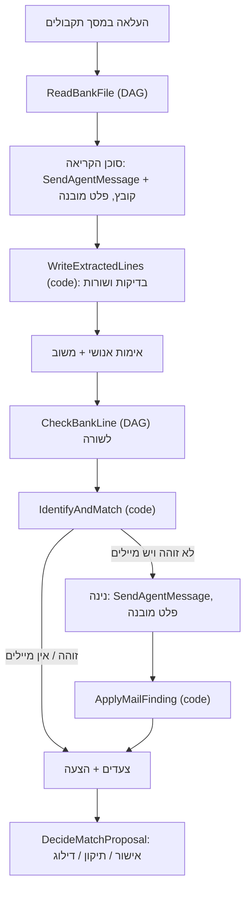

# ארכיטקטורת התקבולים – Ciment Collections (Iteration 9, נכתב 25.10.2026)

> **עדכון 27.10:** חיפוש המייל לחשבוניות רץ לבד כשאילתה קבועה (30 יום, אנשי קשר isApContact, סכום / מספרי חשבוניות / שם מעביר), ונינה רק קוראת את מה שנמצא ומציעה חלוקה (ApplyMailFinding invoiceFinding). RunMatching הוצא משימוש. בקשת פירוט = "הוצע". המקור העדכני: DESIGN_01_RECEIPTS.md ו-DESIGN_FLOWS.md; סעיף 4 למטה הוא היסטוריה בנקודות האלה.

> **עדכון (סבב 4):** את המיילים שהחיפוש הקבוע מוצא קורא סוכן נפרד, קורא הפירוטים (RemittanceReader, Iris). לכל מייל הוא מחזיר רלוונטי או לא, וחילוץ עם ציטוטים. ApplyMailFinding (remittanceRead) בודק את הקריאה, ונינה משלבת אותה בקוד עם הערות הגיול. המקור: DESIGN_01_RECEIPTS.md.

המסמך מתאר את תהליך התקבולים מקצה לקצה: מקובץ הבנק עד התאמה מאושרת. התוכנית שממנה הוא נגזר היא BUILDER_PLAN.md (Iteration 9). היא אושרה ונבנתה ב-25.10, וההחלטות קופלו ל-STORY.md. נקבע בבנייה: חשבונית בודדת בסכום מדויק נחשבת "סכום = פירעון זהה" (ודאי) גם כשהפירעון רחוק, ו"שם + סכום + פירעון סמוך" חל רק על חשבונית שחולקת את תאריך הפירעון עם אחרות. זה עולה ליניב יחד עם שאלת הפירעון הסמוך.

## 1. העיקרון
- **שני סוכנים עם גבול חד.**
  - **סוכן הקריאה (BankFileReader)** הופך מסמך לשורות. אין לו שם ואין לו אווטאר (בקשת סער): במסך הוא שלב "קריאת הקובץ" עם אייקון של מסמך.
  - **נינה (CollectionsAgent)** הופכת שורה להצעת התאמה עם שרשרת ראיות.
- **מה דטרמיניסטי ומה AI.** כל מה שאפשר לחשב (סכומים, פירעונות, שמות, כינויים, כפילויות, סיכומי קובץ) רץ ב-code actions דטרמיניסטיים. AI משמש רק בשני מקומות:
  - קריאת המסמך (סוכן הקריאה);
  - קריאת מיילים כדי להחליט אם מייל מודיע על העברה מסוימת (נינה).
- **אדם מאשר כל התאמה.** שום דבר לא נשלח, ושום דבר לא נכתב ל-Priority.
- **כל צעד נרשם** (ReceiptCheckSteps), וכל "צדק / טעה" נשמר (AgentFeedback). מה שהפאנל מציג הוא בדיוק מה שנרשם, וזה הבסיס ל-evals.

## 2. הזרימה

## 3. שלב א – קריאה (סוכן הקריאה)

**קלט:** הקובץ שהועלה (PDF, Excel, CSV או תמונה), יום העבודה, ומי העלה.

**ReadBankFile (DAG):**
1. **CreateImportBatch (code).** יוצר שורה ב-ImportBatches עם kind=קובץ בנק, extractionStatus=בקריאה, workDay, fileUrl ו-readerAgent=BankFileReader. קובץ זהה (אותו שם ואותו גודל ביום אחד) מוחזר כקיים ולא נקרא שוב.
2. **SendAgentMessage לסוכן הקריאה.** ‏files=[fileUrl], threadId=`bankfile-<batchId>`, structuredOutputJsonSchema:
   - `account`, `periodFrom`, `periodTo`, `linesInFile` (number או null), `totalInFile` (number או null);
   - `lines[]`: lineNo, valueDate, amount, payerName, reference, lineType (העברה, צ׳ק, צ׳ק חוזר, אחר), sourceRef (`p2:r14` או `row 14`), rawText, legibility (טובה, בינונית, נמוכה);
   - `warnings[]`.
3. **WriteExtractedLines (code).** מקבל את הפלט ואת batchId, בודק, וכותב:
   - **שדות חובה:** valueDate תקין, amount שונה מ-0, ו-payerName או reference. אם חסר, יש דגל "שדה חסר" והשורה נשמרת.
   - **כפילויות:** אותו valueDate, אותו amount, אותו payerName ואותה reference מול BankLines קיימות. כפילות מסומנת ולא נכתבת שוב.
   - **סיכומים:** extractedLineCount ו-extractedTotal מושווים ל-linesInFile ו-totalInFile, והתוצאה ב-totalsCheck היא תואם, לא תואם או אין סיכום בקובץ.
   - **כתיבה:** BankLines במצב status=חדשה ו-checkStage=ממתינה לבדיקה, עם lineNo, sourceRef ו-rawText. ‏source הוא test-fixture כשהחשבון מתחיל ב-TEST-, ו-priority-file בכל מקרה אחר.
   - **קריאה חוזרת:** השורות נקראות מחדש מהטבלה. אם כולן נמצאו (writeVerified), הקובץ עובר ל"נקרא – לאימות". אחרת הוא עובר ל"נכשל" עם השגיאות.
   - **צעד ב-ReceiptCheckSteps:** stage=קריאה, actor=סוכן הקריאה, עם הסיכום.

**אימות אנושי (המסך):**
- **תיקון שדה בשורה** מעדכן את BankLines (correctedBy, correctedAt) וכותב AgentFeedback עם verdict=טעה, field, valueGiven ו-valueCorrect.
- **"צדק"** כותב AgentFeedback עם verdict=צדק. שורה שלא סומנה לא נספרת.
- **"אישור השורות והתחלת בדיקות"** קורא ל-ConfirmExtractedLines (code), שמעדכן extractionStatus=אומת, status=נכתב, checkStatus=בבדיקה, verifiedBy/At ו-checkStartedBy/At.
- **כשה-totalsCheck הוא "לא תואם"**, האישור דורש סימון מפורש: "בדקתי מול הבנק".

**ההוראות של סוכן הקריאה (תמצית):**
- מעתיקים, לא מנחשים. שדה שלא נקרא יוצא ריק עם legibility נמוכה.
- שורות "יתרה", "סה״כ" ו"יתרת פתיחה" אינן תנועות. רק זיכויים הם תקבולים, וחיוב שמקורו בצ׳ק חוזר יוצא כ-lineType=צ׳ק חוזר.
- את linesInFile ו-totalInFile לוקחים רק מסיכום שמופיע בקובץ ולא מחשבים.

## 4. שלב ב – בדיקה (נינה)

**הפעלה:** המסך קורא ל-CheckBankLine לשורה הבאה לפי lineNo ומחכה לסיום. אחרי ההחלטה של האחראית הוא ממשיך לשורה הבאה. "עצור" מסמן checkStatus=הושהתה. החזרה דרך רשימת הרשומות פותחת את השורה במצב שבו היא נמצאת.

**CheckBankLine (DAG):**
1. **IdentifyAndMatch (code)** קורא ל-loadMatchingData הקיים (לקוחות, כינויים, אנשי קשר, חשבוניות פתוחות, הזמנות שמורות), ומבצע:
   - **צ׳ק חוזר:** נפתחת משימה דחופה ב-CollectionQueue (כמו היום), והשורה עוברת ל-checkStage=דולגה, כי היא לא תקבול.
   - **שלב 1 – כרטיס לקוח:** התאמה מנורמלת של payerName לשם הלקוח (normName הקיים, כולל הסרת "בדיקה –"), ח״פ שמופיע בהפניה, ושם של איש קשר. יותר מלקוח אחד = דו-משמעי.
   - **שלב 2 – כינוי מאושר:** BankAliases במצב status=מאושר. כינוי שנדחה לא משמש.
   - **שלב 3 – מיילים (מאז 25.10: רק באישור).** בלי אישור לא נקרא שום מייל. המדרגה נרשמת "ממתין לאישור" עם evidence.proposedQuery: נינה מכינה מה לחפש, מילים מהשם, הסכום ו-7 ימים. המשתמש מאשר או עורך את החיפוש, עד 30 יום, וזה מריץ את ה-DAG SearchLineMail: IdentifyAndMatch עם mailSearch, אחריו נינה, ואחריו ApplyMailFinding. הרצה חוזרת משתמשת שוב בממצא מייל שכבר אומת (reused=true) ולא קוראת מחדש. כללי החיפוש כשהוא רץ:
     - נאספים מועמדים מ-InboundEmails לפי daysBack שאושר;
     - קריטריונים: fromName, subject או bodyText שמכילים טוקן משמעותי מ-payerName, או סכום זהה בגוף המייל (כולל פורמטים 17,424 / 17424 / 17,424.00);
     - עדיפות לקטגוריות פירוט תשלום, הבטחת תשלום ואחר, ולמיילים מאנשי קשר רשומים ומסוכני סימנט (SalesAgents);
     - עד 8 מועמדים. מייל "לא רלוונטי" נבדק לפי נושא ושולח בלבד, כי הגוף שלו נמחק.
   - **שלב 4 – WhatsApp סוכנים:** צעד עם result=בהגדרה. לא בנוי.
   - **מאז 27.10 (רכיב 04):** פירוט מייל הוא המדרגה הראשונה, וקריאה מאומתת מחליפה תמיד הצעה לפי סכום, הערה או פירעון סמוך. החיפוש מתחיל ממיילי "פירוט תשלום" של הלקוח. איריס מקבלת את תוכן הקבצים, ו-ApplyMailFinding מקבלת ציטוט מקובץ. הסדר שלמטה הוא ההיסטוריה של 25.10.
   - **התאמה, אם יש לקוח (הסדר מאז 25.10):**
     - (מאז 25.10, ערב) היתרה הפתוחה היא אחרי תשלומים שכבר אושרו (שכבת החשבוניות, shared/collections-invoice-layer.ts);
     - סכום ששווה לסך חשבוניות עם אותו dueDate. הערות גיול על החשבוניות מצורפות כראיה, והערת בירור היא אזהרה;
     - הערת גיול (R_NOTE): הערת הבטחה או "שולם לטענת" עם אותו סכום (±1) או שסך החשבוניות שלה שווה לסכום, ו-actionDate עד noteMatchDays (7) מ-valueDate. ודאי אם סך החשבוניות שווה או שהאסמכתא מופיעה בשורה, אחרת גבוה; שתי הערות = דו-משמעי. מכריעה גם בין חשבוניות תאומות. נקראות הערות מ-60 הימים האחרונים;
     - שם + סכום חשבונית אחת + dueDate בטווח nearDueDays (14) מ-valueDate. הוודאות כאן "גבוה" ולא "ודאי";
     - אף פעם לא לפי סכום, כשיש שתי חשבוניות פתוחות באותו סכום באותו חודש. מקרה כזה ממשיך למדרגת המייל;
     - פירוט מייל:
       - קודם, מספרי החשבוניות מהמייל שזיהה את הלקוח;
       - אחרת, חיפוש שאושר במיילי הלקוח;
       - אחרת, המדרגה "ממתין לאישור".
       - אם נמצאה התאמה לפי סכום, המדרגה נרשמת "דולג";
     - אין התאמה ויש לקוח: טיוטת "בקשת פירוט" ב-Approvals להנהלת החשבונות של הלקוח (detailRequestDraft הקיים), שנעצרת ב"אושר – לא נשלח".
   - **כתיבה:** כל צעד נכתב ל-ReceiptCheckSteps, והתוצאה נכתבת ל-MatchProposals (מוצעת) ול-BankLines.checkStage.
2. **נינה (SendAgentMessage).** רק כשהזיהוי נכשל ויש מועמדים. ‏threadId=`receipt-<bankLineId>`. הפרומפט כולל את שורת הבנק, את המועמדים (מזהה, שולח, תאריך, נושא, קטע גוף) ואת רשימת הלקוחות שהוזכרו בהם. פלט מובנה:
   - `found` (boolean), `customerCode` (string או null), `emailId`, `quote` (ציטוט מדויק מהמייל), `reason`;
   - `confidence` (גבוה, נמוך).
3. **ApplyMailFinding (code)** מוודא שה-quote באמת מופיע במייל ושה-customerCode קיים. אם לא, הממצא נדחה ונרשם. אחר כך הוא רושם את הצעד ומריץ את שלב ההתאמה של IdentifyAndMatch על הלקוח שנמצא.

**החלטת האחראית (DecideMatchProposal, מורחב):**
- **approve:**
  - ההצעה וה-BankLine עוברים ל"אושרה – לביצוע ב-Priority";
  - ההבטחות של החשבוניות עוברות ל"נראה תשלום" (קיים);
  - אם payerName שונה משם הלקוח ואין כינוי, נכתב BankAliases עם status=מאושר, source לפי שיטת הזיהוי (מייל, אישור התאמה, ידני), evidenceEmailId ו-prioritySync=לא סונכרן.
- **correct:** בחירת לקוח ו/או חשבוניות. נוצרת הצעה חדשה ב"ידני", הקודמת מסומנת "הוחלפה", ונכתב AgentFeedback לנינה עם verdict=טעה.
- **skip:** checkStage=דולגה, והשורה נשארת פתוחה.
- **priorityDone:** קיים.
- **רישום:** כל החלטה נכתבת גם כצעד עם actor=משתמש.

## 5. נתונים
- **הסכמה המלאה:** ראו BUILDER_PLAN.md, סעיף Data.
- **טבלאות חדשות:** ReceiptCheckSteps, AgentFeedback.
- **טבלאות שמתרחבות:** ImportBatches, BankLines, MatchProposals, BankAliases.
- **views:** ReceiptsByBatch (רצועת השבוע), AgentFeedbackStats.
- **שיוך יום:** workDay = התאריך המקומי של ההעלאה (Asia/Jerusalem). ו׳ ו-ש׳ נספרים ליום ה׳.
- **רצועת השבוע:** א׳–ה׳ של השבוע הנוכחי. בחצות היום מתחלף, בלי שום פעולה, כי זה חישוב לפי שעון.

## 6. סוכנים
| סוכן | כלים | צ׳אט | Evals |
|---|---|---|---|
| סוכן הקריאה (BankFileReader, בלי פרסונה, title תפקידי "קורא קובצי בנק" בלי תמונה) | אין | אין | golden לכל קובץ דוגמה (קובץ מצורף, שורות צפויות). ‏metrics: מספר שורות, כל שדה מדויק (geval compareToExpected), בלי שורות מומצאות |
| נינה (CollectionsAgent) | CheckBankLine (dryRun), SearchRecentEmails, GetCustomer360, DecideMatchProposal (approval: ask) | NinaChat (/nina), AskNinaChat (רק בתקבולים) | זיהוי ממייל (TEST-001 "אבי ובניו"), הודעת סוכן, אין מייל → לא מזוהה, ומקרה קצה: סכום זהה ושם אחר → לא מסיקה. ‏metrics: לקוח נכון, ציטוט קיים, לא ממציאה |
| ~~נורה (AgingAgent)~~ | הוסרה ב-26.10: כל הכלים שלה הם קוד שרץ מהמסכים ומריצת הבוקר; הצעות הגדלת ביטוח עברו לכפתור במסך היום | — | — |

**ריצת הבוקר (קוד, בלי סוכן; נורה הוסרה ב-26.10):** MorningRun, א׳–ה׳ 07:30 שעון ישראל: CheckPromises ואחריו WriteBriefing. ‏OnMorningImport ו-MorningBankImportPipeline נמחקים.

## 7. מדידה ו-evals
- **ספירה:** AgentFeedbackStats מציג לכל סוכן ושבוע כמה צדק, כמה טעה ובאיזה שדה.
- **הפיכה ל-golden:** משוב "טעה" עם תיקון הוא golden מוכן.
  - **סוכן הקריאה:** הקובץ, יחד עם השורות אחרי התיקון.
  - **נינה:** השורה והמיילים, יחד עם הלקוח הנכון.
- **שני סוגי בדיקות:**
  - **בדיקות יחידה לקוד:** הסולם, הסכומים, פירעון סמוך, כפילויות, סיכומי קובץ. רצות בכל בנייה.
  - **evals לסוכנים:** רצים מלוח ה-Evals של כל סוכן. ההרצה עולה כסף ולכן ידנית.
- **יעדים מוצעים (לאישור יניב):** סוכן הקריאה 99.5% שדות נכונים ו-100% שורות. נינה 80% זיהוי אוטומטי (ההערכה של יניב 70–80%), ו-0 זיהויים שגויים שאושרו.

## 8. כשלים והתאוששות
- **סוכן הקריאה נכשל או החזיר פלט ריק:** הקובץ עובר ל"נכשל" עם הסיבה, ואפשר להעלות שוב. אין כתיבה חלקית: שורות נכתבות רק אחרי שכל הבדיקות עברו.
- **הסיכומים לא תואמים:** הקובץ ממשיך, עם אזהרה ואישור מפורש.
- **נינה לא ענתה, או ענתה עם ציטוט שלא קיים:** הצעד נרשם "לא נמצא (תשובה לא אומתה)", והרשומה ממשיכה כלא מזוהה.
- **האחראית סגרה את המסך באמצע:** הרשומה נשארת ב-checkStage האחרון. CheckBankLine אידמפוטנטי: הרצה חוזרת מחליפה הצעה "מוצעת" ולא מכפילה.
- **מגבלת קריאות:** מסך הבדיקה קורא ל-CheckBankLine לשורה אחת בכל פעם, ולא חוזר על אותה שורה בתוך 20 שניות (הלקח מהקפיאה, useActionQuery).

## 9. חוסרים עד פרודקשן
1. **נתוני Priority אמיתיים:** כרטיסי לקוח, אנשי קשר וחשבוניות פתוחות. בלי זה הסולם עובד רק על TEST-001..010. הגישה היא API, או ייבוא יומי של חשבוניות פתוחות (המשימה שעוד ממתינה ב"היום").
2. **קבצי בנק אמיתיים:** 3–5 קבצים מושחרים עם התוצאה הנכונה. זה ה-golden האמיתי הראשון של סוכן הקריאה, והוא קובע אם צריך מודל אחר ל-OCR.
3. **Evals אמיתיים:** כרגע הם ממציאים ומסומנים כך. אחרי שבועיים של משוב בפאנל בונים goldens מהטעויות.
4. **מיילים:** רק תיבת הבדיקה saar@blocks.diy (תווית Ciment-Test) מחוברת, ולכן שלב המיילים רואה רק אותה.
   - **מה פותח את התיבות האמיתיות:** תיבות Outlook של האחראיות דורשות אישור של אבי (סמנכ״ל כספים) ושל גילה (סמנכ״לית מערכות מידע), ואת סקירת האבטחה של דן. ההחלפה היא workflow מתאם נוסף, בלי שינוי בלוגיקה.
   - **סיכון:** מייל שמאיה סיווגה בטעות כ"לא רלוונטי" מאבד את הגוף שלו, ושלב המיילים יראה רק נושא ושולח.
5. **WhatsApp סוכנים:** ה-flow לא מוגדר (סער ויניב), וחיבור WhatsApp Business לא קיים.
6. **Priority:** כינויים נשמרים אצלנו (prioritySync=לא סונכרן), וקבלות נבנות ידנית ב-Priority. סנכרון דו-כיווני וכתיבה דורשים API עם הרשאת כתיבה.
7. **אוטומציה:** הבדיקות מתחילות בלחיצה. המעבר לאוטומטי הוא טריגר על extractionStatus=אומת, או ישר אחרי הקריאה, כשהלקוח מרוצה.
8. **הרשאות:** אין תפקידים. כל אחראית מאשרת כל רשומה וכל כינוי. אם יניב ירצה הגבלה, זה role ושומר במסך.
9. **עלות:** קריאה אחת של סוכן הקריאה לכל קובץ, ונינה רק לשורות שלא זוהו בקוד. לפי ההערכה של 70–80% זיהוי, נינה נקראת ל-20–30% מהשורות.
